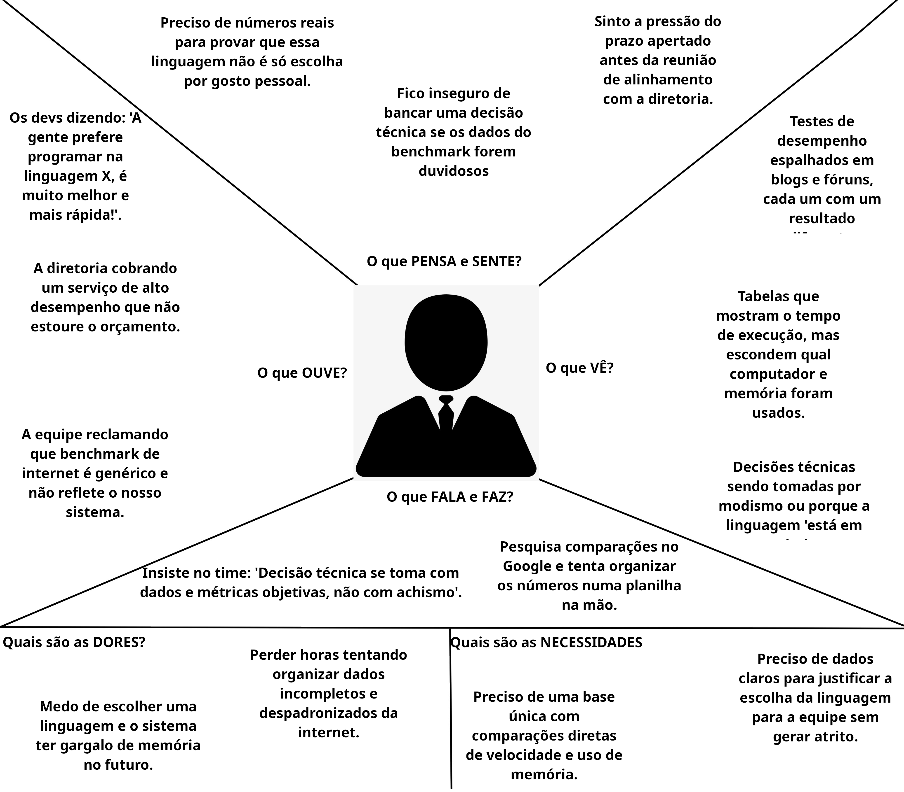

# Entrega 3 — Personas, mapa de empatia, contexto de uso e jornada

**Data:** 14/10/2005  
**Status:** 🟩 em andamento`  
**Responsabilidade:** 1 persona por integrante; 1 mapa de empatia, 1 contexto de uso consolidado e 1 jornada por equipe (salvo orientação diferente do docente).

## Objetivo da atividade

Representar grupos de usuários de forma útil para decisões de design. Persona não é personagem decorativo: suas características devem alterar requisitos, prioridades, linguagem, fluxos ou critérios de avaliação.

## Atenção a projetos técnicos

Em TCCs sem interface original, a persona pode representar um **profissional que se apropria da contribuição técnica**: DBA, analista, cientista de dados, administrador, pesquisador, técnico, operador, gestor ou especialista de domínio.

Não escolha um perfil apenas porque “parece combinar” com a tecnologia. Explique **qual objetivo esse perfil teria e qual parte da contribuição do TCC produziria valor para ele**. Se ainda for hipótese, mantenha como hipótese/proto-persona a validar.

Também considere papéis diferentes quando houver tarefas distintas, por exemplo:

- operador que executa análises;
- administrador que configura e gerencia permissões;
- especialista que interpreta resultados;
- gestor que consulta relatórios e decide;
- auditor que revisa histórico.

## Entradas da Entrega 1

Antes de criar personas, retome os tipos de usuários, características relevantes, objetivos e hipóteses registradas na Entrega 1. A persona **não deve transformar uma hipótese inicial em fato por meio de uma história fictícia**.

| Item da Entrega 1 | Status inicial | Evidência disponível agora | Como será tratado nesta entrega |
| --- | --- | --- | --- |
| Desenvolvedores como público prioritário | F | Definição registrada na Entrega 1 e retomada na Entrega 2 | Incorporar como público principal e base da persona P01 |
| Escolha de linguagens com base em métricas de desempenho | F | Objetivo de uso definido na Entrega 1 | Incorporar como objetivo principal da persona P01 |
| Comparação manual ou enviesada entre linguagens | H | Levantamento inicial da Entrega 1 sobre como o problema pode ser resolvido atualmente | Manter como hipótese e usar como base para  as personas P01 e P02 |
| Interesse em consultar resultados de diferentes problemas e linguagens | H | Escopo proposto para a ferramenta e análise do Debian Benchmark Game na Entrega 2 | usar como necessidade provável e como base para P02 |
| Necessidade de visualizar e filtrar resultados | H | Funcionalidades F01 e F02 da Entrega 1 e análise de ferramentas semelhantes na Entrega 2 | Incorporar como necessidade de interação, ainda sujeita a validação |
| Interesse acadêmico na análise de benchmarks | H | Contexto acadêmico considerado na Entrega 1 | Usar como base para a persona P02, mantendo como hipótese |

## 1. Personas

### Persona P01 — Rafael Mendes, gestor de projetos de software

**Autor:** João Pedro Bazoli Palma — 24.123.041-6

**Tipo:** primária

**Base de evidências:** proto-persona a validar, baseada nas Entregas 1 e 2

**Hipóteses da Entrega 1 relacionadas:** H01, H03
| Campo | Descrição |
| --- | --- |
| Faixa etária / contexto relevante | 42 anos de idade 20 anos de experiẽncia na  |
| Ocupação/papel | Gestor de projetos de software responsável por avaliar alternativas técnicas e orientar decisões de desenvolvimento. |
| Conhecimento do domínio | Conhece diferentes linguagens de programação e entende que o desempenho varia conforme a linguagem, o algoritmo e o problema. Também conhece os requisitos técnicos do projeto que supervisiona. |
| Experiência tecnológica | Utiliza computadores e ferramentas de desenvolvimento no cotidiano profissional e tem acesso à internet para pesquisar soluções técnicas. |
| Objetivos | Identificar uma linguagem de programação adequada às necessidades e aos objetivos do projeto que supervisiona. |
| Necessidades | Encontrar informações comparáveis e confiáveis que ajudem a justificar sua escolha de linguagem para a equipe e para o projeto. |
| Dores/frustrações | Tem dificuldade para distinguir resultados de desempenho relevantes para seu projeto e evitar que a escolha seja influenciada apenas pela popularidade das linguagens ou por preferências pessoais. |
| Motivadores | Tomar uma decisão técnica bem fundamentada, que contribua para o sucesso do projeto e reduza o risco de escolhas inadequadas. |
| Restrições/acessibilidade | Depende de um computador, navegador e conexão com a internet para consultar os resultados. Outras restrições ainda não foram investigadas. |
| Ambiente típico de uso | Provavelmente utiliza a ferramenta no ambiente de trabalho, durante a análise de alternativas técnicas ou o planejamento do projeto. |
| Comportamentos relevantes | Pesquisa informações sobre linguagens, compara resultados de benchmarks e considera métricas de desempenho para apoiar sua decisão. A sequência exata dessas atividades ainda precisa ser investigada. |

**Decisões de design influenciadas por P01:**

- Permitir selecionar o problema que deseja analisar e filtrar os resultados por critérios relevantes.
- Apresentar resultados de diferentes linguagens de maneira comparável, com métricas claramente identificadas.
- Disponibilizar informações sobre as condições dos testes, incluindo o hardware utilizado, para ajudar a interpretar os resultados.
- Evitar apresentar uma linguagem como universalmente superior sem considerar o problema e as condições da comparação.
- Permitir que o usuário consulte explicações resumidas sobre os problemas avaliados.

### Persona P02 — Mariana Costa, estudante e pesquisadora de computação

**Autor(a):** Augusto Pereira Teixeira — 24.123.008-5

**Tipo:** secundária

**Base de evidências:** proto-persona a validar, baseada nos contextos acadêmicos considerados na Entrega 1

**Hipóteses da Entrega 1 relacionadas:** H01, H03

| Campo | Descrição |
| --- | --- |
| Faixa etária / contexto relevante | 24 anos, cursando mestrado na área de computação. |
| Ocupação/papel | Estudante e pesquisadora de computação interessada em investigar o desempenho de diferentes linguagens de programação. |
| Conhecimento do domínio | Possui conhecimentos de programação e familiaridade com algoritmos, experimentação e análise de resultados. |
| Experiência tecnológica | Utiliza computadores e ferramentas digitais para estudar, consultar documentação técnica e acessar estudos acadêmicos. |
| Objetivos | Comparar o desempenho de linguagens em diferentes problemas e compreender os fatores que influenciam os resultados. |
| Necessidades | Encontrar resultados organizados, conhecer as métricas utilizadas e entender as condições em que os testes foram realizados. |
| Dores/frustrações | Pode encontrar dificuldades para reunir resultados de diferentes fontes ou interpretar comparações que não apresentam detalhes suficientes sobre os testes.|
| Motivadores | Aprofundar seus conhecimentos sobre desempenho de linguagens e utilizar resultados confiáveis como apoio às suas pesquisas acadêmicas. |
| Restrições/acessibilidade | A proposta considera acesso a computador, navegador e internet.|
| Ambiente típico de uso | Possivelmente em casa, em laboratório ou na universidade, durante atividades de estudo e pesquisa. |
| Comportamentos relevantes | Pode pesquisar benchmarks, selecionar problemas de interesse, comparar métricas e consultar os resultados para orientar seus estudos ou experimentos. O comportamento real precisa ser investigado. |

### Síntese das personas

Explique diferenças entre os perfis e qual persona é prioritária. Evite personas duplicadas que só mudam nome/foto.

## 2. Mapa de empatia — equipe

**Persona escolhida:** {{P01}}  
**Justificativa:** {{por que esse perfil é relevante}}

## 3. Contexto de uso — consolidação

| Dimensão | Descrição | Implicação de design |
|---|---|---|
| **Usuários** | Desenvolvedores, gestores (P01) e pesquisadores (P02) com bagagem técnica. | Interface objetiva, sem tutoriais sobre conceitos básicos de programação. |
| **Tarefas** | Comparar desempenho de linguagens e filtrar testes por tipo de problema. | *Dashboard* com gráficos interativos e tabelas dinâmicas ordenáveis. |
| **Equipamentos** | Desktops e notebooks com navegador web e conexão à internet. | Layout otimizado para telas maiores, acomodando dados e gráficos amplos. |
| **Ambiente físico** | Escritórios, *home office* e laboratórios acadêmicos. | Design limpo e legível para minimizar o cansaço em análises longas. |
| **Ambiente social / organizacional** | Equipes de software, reuniões de planejamento e grupos de pesquisa. | Resultados fáceis de interpretar e compartilhar para fundamentar escolhas. |
| **Papéis / permissões / governança** | Consulta pública e irrestrita; gestão restrita aos mantenedores. | Acesso direto aos dados, sem necessidade de *login* ou cadastro. |
| **Volume de dados / histórico** | Histórico de execuções, especificações de *hardware* e versões. | Exibição clara do contexto dos testes (*hardware*, comandos e datas). |

## 4. Jornada do usuário — equipe

- Persona: Rafael Mendes (Gestor de Projetos de Software).
- Objetivo: Escolher e justificar a linguagem de programação ideal para um novo projeto com dados reais.
- Início e fim: Começa no planejamento do projeto e termina na apresentação da escolha para a equipe.

| Etapa | Ação do usuário | Objetivo | Pensamento / Sentimento | Dor / Obstáculo | Oportunidade de design |
| -------------------------------- | ----------------------------------------------------------------------------------- | --------------------------------------------------------- | -------------------------------------------------------------------------------------------- | --------------------------------------------------------------------- | ---------------------------------------------------------------------------- |
| 1. Surgimento da necessidade | Inicia o planejamento do novo sistema e precisa definir a linguagem de programação. | Escolher a melhor opção técnica para o projeto. | *"Quero uma escolha baseada em desempenho real, não em preferências da equipe."* (Cauteloso) | Risco de escolher por moda, hábito ou gosto pessoal. | Tela inicial direta, focada em categorias de problemas práticos. |
| 2. Busca por comparações | Pesquisa comparações e testes de desempenho na internet. | Encontrar comparações confiáveis entre as linguagens. | *"Os testes na internet são genéricos e não mostram o cenário real."* (Frustrado) | Dados espalhados e sem detalhes sobre o computador usado nos testes. | Reunir comparações padronizadas e transparentes sobre os testes. |
| 3. Filtragem de dados | Acessa a plataforma e filtra pelo tipo de problema do seu projeto. | Ver apenas as informações relevantes para o seu cenário. | *"Preciso ver como as linguagens se saem exatamente nesse tipo de tarefa."* (Focado) | Excesso de informações genéricas que não ajudam a decidir. | Filtros simples para ordenar por velocidade e consumo de memória. |
| 4. Análise dos resultados | Examina os gráficos e tabelas com os resultados obtidos. | Comparar tempo de execução e consumo de memória. | *"O gráfico facilita muito ver a diferença de consumo de memória."* (Confiante) | Dificuldade para entender dados brutos em tabelas longas e complexas. | Painel visual com gráficos claros e resumos simples de cada problema. |
| 5. Tomada de decisão | Reúne as informações e apresenta a recomendação para o time. | Explicar e defender a escolha da linguagem para a equipe. | *"Tenho dados concretos para mostrar por que essa linguagem é a melhor."* (Satisfeito) | Receio de questionamentos da equipe sobre a escolha feita. | Opção de compartilhar os gráficos e relatórios da comparação de forma direta. |
## Síntese

A Entrega 3 mostra que a principal necessidade do gestor (Rafael Mendes — P01) é tomar decisões técnicas baseadas em dados concretos, evitando comparações dispersas e enviesadas da internet. Para atender a esse perfil, a interface de IHC deve ser direta, sem cadastro obrigatório e com gráficos claros sobre o contexto dos testes. Esses aprendizados fundamentam a **Entrega 4 (Análise do Problema)**, em que essas dores serão transformadas em cenários narrativos para diagnosticar os problemas atuais e guiar o design.

## Checklist

- [x] Existe pelo menos uma persona por integrante.
- [x] As personas não são apenas diferenças demográficas superficiais.
- [x] Está claro o que é dado real e o que é hipótese/proto-persona.
- [x] A persona não “validou por ficção” uma hipótese da Entrega 1; afirmações continuam marcadas como hipótese quando não há evidência.
- [x] Objetivos e dores têm consequência para o design.
- [x] Contexto de uso está coerente com a Entrega 1.
- [x] Em TCC sem interface original, a persona possui relação explícita com a contribuição técnica.
- [x] Papéis administrativos, técnicos e decisórios só foram criados quando possuem objetivos/tarefas diferentes.
- [x] Jornada possui etapas, dores e oportunidades e não é apenas wireflow.
- [x] IDs das personas foram adicionados à rastreabilidade.
