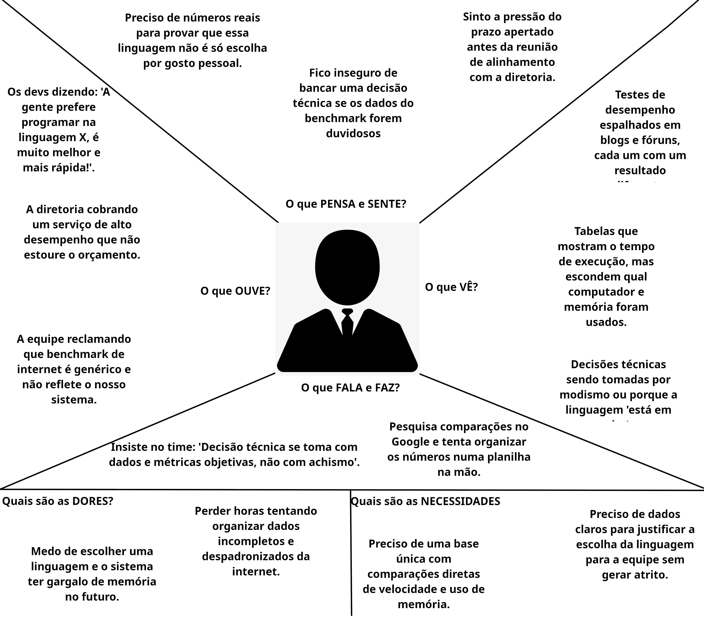

### Entrega 3 — Personas, mapa de empatia, contexto de uso e jornada

**Data:** 14/10/2026 (Revisado em 18/11/2026)

**Status:** 🟩 concluída

**Responsabilidade:** João Pedro Bazoli Palma (P01 e Mapa de Empatia); Augusto Pereira Teixeira (P02); Contexto de uso e Jornada consolidados pela equipe.

#### Objetivo da atividade

Representar grupos de usuários representativos para orientar decisões sistemáticas de design. As personas e jornadas funcionam como balizadores empíricos para definir requisitos, hierarquia visual, fluxos de interação e critérios de avaliação do BMML.

---

#### Entradas da Entrega 1

Mapeamento de insumos e evolução do conhecimento da equipe desde a fase exploratória:

| Item da Entrega 1 | Status inicial | Evidência disponível | Como foi tratado nesta entrega |
| :--- | :---: | :--- | :--- |
| **Desenvolvedores como público prioritário** | F | Retomado na Entrega 2 e alinhado ao escopo técnico do TCC. | Mantido como público-alvo central. A persona primária P01 foi especificada como *Tech Lead* (desenvolvedor sênior em papel de liderança técnica). |
| **Escolha técnica baseada em métricas de desempenho** | F | Problema central do domínio de sistemas e compilação. | Incorporado como objetivo de interação da persona P01. |
| **Comparação manual dispersa e enviesada** | H | Confirmado na inspeção de concorrentes (Entrega 2). | Mantido como problema central a ser superado pelas personas P01 e P02. |
| **Consulta a múltiplos problemas e linguagens** | H | Observado no catálogo do Rosetta Code e Debian Game. | Modelado como necessidade fundamental da persona secundária P02. |
| **Necessidade de filtrar séries e visualizar gráficos** | H | Lacuna crítica identificada nos concorrentes analisados. | Definido como hipótese central de interação a ser prototipada. |
| **Demanda por reprodutibilidade acadêmica** | H | Requisito do rigor científico em benchmarks de computação. | Base para a persona P02, exigindo acesso a dados de calibração de hardware e scripts. |

---

#### 1. Personas

##### Persona P01 — Rafael Mendes, Líder Técnico de Desenvolvimento (Tech Lead)

* **Autor:** João Pedro Bazoli Palma — 24.123.041-6
* **Tipo:** **Primária** (o design do visualizador e da tabela interativa é orientado prioritariamente para atender às suas restrições operacionais e decisórias).
* **Base de evidências:** Proto-persona fundamentada nas Entregas 1 e 2, mantida sob hipótese até os testes empíricos.
* **Hipóteses da Entrega 1 relacionadas:** H01, H03.

| Campo | Descrição |
| :--- | :--- |
| **Identidade e Dados Demográficos** | 42 anos, graduado em Ciência da Computação com especialização em Engenharia de Software. 20 anos de experiência prática no desenvolvimento de sistemas backend de alto desempenho. |
| **Trajetória e Perfil Biográfico** | Iniciou a carreira programando em C e C++ para sistemas embarcados e telecomunicações. Ao longo dos anos, acompanhou a evolução de novas linguagens (Go, Rust, Zig). Atualmente atua como *Tech Lead* em uma empresa de tecnologia financeira, liderando uma equipe de 8 engenheiros de software. Embora ainda faça revisões de código (*code review*) e programe módulos críticos, sua responsabilidade principal é definir a arquitetura dos microsserviços e garantir que as escolhas tecnológicas sejam sustentáveis a longo prazo. |
| **Relacionamentos e Dinâmica Social** | Responde tecnicamente à gerência de engenharia e à diretoria de operações. No dia a dia, gerencia as pressões da equipe de desenvolvedores: profissionais mais jovens fazem forte pressão para adotar linguagens modernas por preferência pessoal, enquanto membros mais conservadores preferem manter a base legada. Rafael precisa mediar esses conflitos apresentando dados numéricos incontestáveis. |
| **Objetivos e Tarefas** | **Objetivo:** Identificar e fundamentar qual linguagem é a mais adequada às restrições de tempo de execução e consumo de memória para um novo microsserviço crítico. **Frequência:** Tarefa eventual/periódica (a cada início de projeto ou revisão de gargalo), com duração estimada de 30 a 60 minutos de análise concentrada. |
| **Necessidades de Informação** | Comparar métricas relativas sumarizadas (médias de tempo e pico de memória RSS) lado a lado; isolar rapidamente duas ou três linguagens concorrentes; consultar o tipo de carga do algoritmo (`CPU-bound` vs. `Memory-bound`). |
| **Dores e Frustrações** | Perder horas lendo fóruns informais e *benchmarks* isolados da web que não informam a máquina em que os testes rodaram; lidar com o risco de escolher uma linguagem que estoure a memória em produção; insegurança de defender uma escolha técnica diante da diretoria sem evidências reprodutíveis. |
| **Ambiente Típico e Equipamento** | Estação de trabalho corporativa com dois monitores de alta resolução, teclado e mouse ergonômicos; ambiente de escritório sujeito a interrupções frequentes de colegas e reuniões. |

**Consequências para o design (P01):**

* Apresentar gráfico de dispersão direto na tela inicial do benchmark, permitindo enxergar correlações de tempo e memória sem trocar de página.
* Fornecer tabela com médias ordenáveis por coluna e checkboxes para desmarcar linguagens irrelevantes em poucos cliques.
* Oferecer escalas lineares e logarítmicas imediatas via switches, evitando que pontos extremos distorçam a comparação.

---

##### Persona P02 — Mariana Costa, Pesquisadora e Mestranda em Computação

* **Autor:** Augusto Pereira Teixeira — 24.123.008-5
* **Tipo:** **Secundária** (suas necessidades de auditoria e rigor científico são essenciais, mas podem ser atendidas por abas e modais complementares sem descaracterizar a interface focada na tomada de decisão de P01).
* **Base de evidências:** Proto-persona fundamentada no contexto acadêmico da Entrega 1 e no padrão colaborativo do Rosetta Code.
* **Hipóteses da Entrega 1 relacionadas:** H01, H03, H04.

| Campo | Descrição |
| :--- | :--- |
| **Identidade e Dados Demográficos** | 24 anos, graduada em Engenharia de Computação, atualmente no 2º ano de Mestrado Acadêmico na área de Sistemas de Computação e Compiladores. |
| **Trajetória e Perfil Biográfico** | Dedicou sua iniciação científica ao estudo de otimização de compiladores (LLVM e GCC). No mestrado, sua dissertação investiga o impacto de abstrações de custo zero em linguagens modernas em comparação com C tradicional. Tem rotina intensiva de escrita científica e submissão de artigos para congressos de IHC e Sistemas. |
| **Relacionamentos e Dinâmica Social** | Trabalha sob orientação direta de seu professor orientador e colabora com colegas do laboratório de pesquisa. Enfrenta cobrança rigorosa por reprodutibilidade experimental: revisores de artigos científicos frequentemente rejeitam trabalhos cujos benchmarks não detalham versão de compilador, flags de otimização e ambiente determinístico. |
| **Objetivos e Tarefas** | **Objetivo:** Auditar dados de benchmark, verificar flags de compilação aplicadas e obter comandos declarativos para reproduzir experimentos idênticos no laboratório. **Frequência:** Uso frequente em ciclos de submissão de artigos (sessões profundas de 1 a 2 horas). |
| **Necessidades de Informação** | Especificações exatas da máquina física de testes (modelo de CPU, memória RAM física, versão do kernel Linux); acesso ao código-fonte exato executado; comandos de build e receitas de contêineres reprodutíveis (GNU Guix); exportação dos dados brutos em CSV. |
| **Dores e Frustrações** | Encontrar tabelas na web que não informam as flags de compilação (ex.: comparar `-O3` com código sem otimização); impossibilidade de reproduzir testes de terceiros por falta de especificação do ambiente; perda de tempo escrevendo scripts de bancada do zero. |
| **Ambiente Típico e Equipamento** | Laptop de 14 polegadas rodando Linux no laboratório da universidade ou em home office; alternância constante entre navegador web, terminal Bash e editor LaTeX. |

**Consequências para o design (P02):**

* Criar botão ubíquo `About` no cabeçalho permanente, abrindo modal com as especificações da máquina física (CPU Ryzen 5 3600, 32GB RAM).
* Prover aba dedicada de "Código e Reprodutibilidade" contendo visualizador de código com flags (`.ReleaseFast` / `-O3`) e script do GNU Guix com botão de cópia assistida (`Copy`).
* Disponibilizar link direto para download do dataset bruto em formato CSV.

---

##### Síntese das personas e justificativa do elenco

* **Composição do elenco e justificativa de papéis:** O elenco foi estruturado em uma persona primária (**Rafael Mendes — P01**) e uma secundária (**Mariana Costa — P02**). Essa divisão é metodologicamente justificada: o núcleo interativo do BMML foi projetado para resolver o problema crítico de Rafael (interpretar rapidamente dados densos para decidir uma linguagem sob restrição de tempo corporativo). Mariana é classificada como secundária porque uma interface que atenda com excelência a Rafael (gráfico cartesiano limpo e tabela dinâmica) também supre a necessidade exploratória inicial de Mariana. As necessidades específicas dela (auditoria metodológica e reprodutibilidade) são satisfeitas por meio de abas secundárias e diálogos modais, sem poluir a interface principal nem justificar a criação de um sistema paralelo.
* **Diferenciação operacional entre P01 e P02:**
  * **Urgência e Foco:** Enquanto Rafael precisa de respostas consolidadas em poucos minutos para justificar custos e riscos diante de uma equipe, Mariana realiza análises detalhadas e de longa duração voltadas à escrita acadêmica.
  * **Profundidade Técnica:** Rafael concentra-se na relação de *trade-off* entre tempo e consumo de RAM para problemas específicos da empresa; Mariana investiga o rigor metodológico das medições (paridade algorítmica, flags do compilador e determinismo do GNU Guix).
  * **Consequência do Erro:** Para Rafael, uma escolha errada resulta em estouro de orçamento de nuvem e retrabalho da equipe; para Mariana, resulta na rejeição de um artigo científico por falta de reprodutibilidade.

---

#### 2. Mapa de empatia — Equipe (Foco: Rafael Mendes — P01)

> **Nota epistemológica:** Os conteúdos a seguir representam **hipóteses de empatia** estruturadas pela equipe com base na proto-persona P01 e nas observações da Entrega 2. As citações e sentimentos expressos simulam o modelo mental do ator e serão verificados empiricamente nos testes com usuários.

| Dimensão | Conteúdo empático (Hipóteses da equipe) |
| :--- | :--- |
| **O que pensa e sente?** | Preocupa-se com o desempenho real e a sustentabilidade dos sistemas da empresa a longo prazo. Sente-se cauteloso diante do *hype* em torno de novas linguagens. Deseja tomar decisões técnicas respaldadas por números e não por intuição. *"Não posso arriscar a estabilidade da arquitetura por modismo."* |
| **O que escuta?** | Desenvolvedores mais jovens insistindo para reescrever microsserviços em linguagens modernas porque "são mais rápidas". Engenheiros sêniores alertando sobre a dificuldade de contratar profissionais para ecossistemas novos. A diretoria cobrando redução de custos de infraestrutura e prazos rígidos de entrega. |
| **O que vê?** | Artigos na internet com benchmarks contraditórios que omitem dados da máquina de testes. Tabelas gigantescas de números brutos difíceis de interpretar em reuniões. Gráficos de mercado simplistas que comparam linguagens em problemas triviais sem valor prático. |
| **O que fala e faz?** | Reúne a equipe técnica para discutir arquitetura e pede dados que comprovem ganhos de desempenho. Tenta montar planilhas manuais para consolidar números de fontes diferentes. Afirma publicamente: *"Toda escolha técnica é um trade-off; precisamos ver tempo e memória juntos antes de decidir."* |
| **Quais são suas dores?** | Pressão por entregas rápidas competindo com o tempo necessário para testar tecnologias. Medo de selecionar uma linguagem com consumo excessivo de memória sob estresse. Dificuldade de convencer a equipe técnica usando apenas opiniões subjetivas. |
| **Quais são suas necessidades?** | Visualizar imediatamente a dispersão entre tempo e memória em problemas reais. Filtrar apenas as tecnologias que a empresa realmente considera adotar. Dispor de dados transparentes e críveis para arquivar como justificativa de arquitetura. |

---

#### 3. Contexto de uso — Consolidação

| Dimensão | Descrição do contexto | Implicação direta / Hipótese de design |
| :--- | :--- | :--- |
| **Usuários e Conhecimento** | Profissionais técnicos (*Tech Leads*, desenvolvedores e pesquisadores) que dominam programação, conceitos de compilação e métricas de sistema. | **Hipótese:** A interface deve ser direta e com alta densidade informacional, dispensando tutoriais elementares sobre o que é tempo de CPU ou memória. |
| **Tarefas e Frequência** | Comparação de desempenho paramétrico entre linguagens e auditoria de código/ambiente. Uso concentrado (sessões de 15 a 45 minutos) em momentos de planejamento ou pesquisa. | **Hipótese:** A interface deve disponibilizar gráficos e dados de forma integrada na mesma tela, reduzindo navegações em múltiplos níveis. |
| **Equipamentos e Dispositivos** | Estações de trabalho desktop e notebooks corporativos com monitores de 14 a 27 polegadas, mouse/trackpad e navegadores modernos. | **Decisão de design:** Otimização para visualização em tela ampla (desktop 1920×1080), permitindo acomodar gráfico cartesiano e tabela sem rolagem truncada. |
| **Ambiente Físico e Iluminação** | Escritórios corporativos, salas de reunião de planejamento, bancadas de laboratório e *home office*, com iluminação artificial constante. | **Decisão de design:** Adoção de tema escuro estrito (*Dark Mode*) com alto contraste visual (WCAG AA), reduzindo o cansaço visual em análises prolongadas. |
| **Ambiente Social e Organizacional** | Ambientes de forte interação social e debate técnico (equipes de engenharia e grupos de pesquisa). Sujeito a interrupções frequentes e pressão por justificativas. | **Hipótese:** Os dados e gráficos precisam ser claros o suficiente para serem projetados em reuniões ou exportados como evidência técnica. |
| **Papéis, Acesso e Governança** | Consulta pública irrestrita. Não há operações de escrita, edição ou cadastro por parte dos usuários finais. | **Oportunidade:** Dispensar fluxos de login, autenticação ou gestão de contas. O usuário acessa diretamente os dados sem barreiras de entrada. |
| **Conexão e Infraestrutura** | Conexão à internet estável em ambiente corporativo/universitário, com alternância constante de janelas (navegador, IDE, terminal). | **Decisão de design:** Aplicação web estática leve, com carregamento instantâneo e sem consumo excessivo de recursos do navegador do usuário. |

---

#### 4. Jornada do usuário — Rafael Mendes (P01)

* **Ator:** Rafael Mendes (*Tech Lead*).
* **Cenário:** Planejamento arquitetural de um novo serviço de processamento intensivo de dados.
* **Escopo:** Inicia na constatação do gargalo técnico e termina na validação da escolha junto à equipe e acompanhamento em produção.

| Etapa da jornada | Ação do usuário | Objetivo em mente | Pensamento / Sentimento (Hipótese) | Dor / Obstáculo atual | Oportunidade de design no BMML |
| :--- | :--- | :--- | :--- | :--- | :--- |
| **1. Surgimento da necessidade** | Identifica a necessidade de escolher uma linguagem com baixo consumo de memória para um novo microsserviço. | Definir a tecnologia mais adequada às restrições do sistema. | *"A equipe quer usar a linguagem da moda, mas o orçamento de nuvem é limitado."* (Cauteloso) | Risco de decidir por preferência pessoal da equipe ou pressão de mercado. | Tela inicial com catálogo organizado por perfil de processamento (`Memory-bound`). |
| **2. Pesquisa de evidências** | Busca comparações e benchmarks de linguagens na internet. | Encontrar testes padronizados e idôneos. | *"Os testes na web são superficiais e não revelam a calibração da máquina."* (Frustrado) | Informações dispersas, metodologias opacas e ausência de dados de hardware. | Disponibilização do botão ubíquo `About` informando CPU, RAM e determinismo. |
| **3. Filtragem paramétrica** | Acessa a ferramenta e seleciona o benchmark representativo (ex.: MergeSort). | Isolar apenas as opções viáveis para a empresa. | *"Preciso comparar diretamente C, Rust e Zig sem o ruído das outras linguagens."* (Focado) | Excesso de curvas concorrentes no mesmo plano gráfico. | Tabela sincronizada com checkboxes para ocultar séries secundárias. |
| **4. Análise de trade-off** | Alterna os eixos e aciona a escala logarítmica no gráfico de dispersão. | Correlacionar ganho de velocidade com custo de memória RAM. | *"Hipótese: a visualização gráfica permite identificar a dispersão muito mais rápido que uma tabela."* (Confiante) | Dificuldade para enxergar diferenças de ordens de grandeza em escalas lineares. | Gráfico de dispersão interativo com toggles rápidos `Log X` e `Log Y`. |
| **5. Tomada de decisão e defesa** | Copia as médias numéricas da tabela para embasar o documento de arquitetura. | Defender e justificar tecnicamente a escolha diante da equipe. | *"Agora tenho métricas objetivas para mostrar por que essa escolha é equilibrada."* (Seguro) | Receio de questionamentos técnicos da equipe sobre as condições dos testes. | Exibição clara das flags de compilação aplicadas e link de download do CSV bruto. |
| **6. Pós-uso e acompanhamento** | Apresenta a decisão na reunião técnica e arquiva o relatório como justificativa de projeto. | Obter consenso da equipe e validar se o sistema atinge as metas em produção. | *"A equipe aceitou os dados e encerramos a discussão com base em fatos."* (Satisfeito) | Necessidade de revisitar os critérios caso os requisitos do sistema mudem futuramente. | Capacidade de consultar benchmarks históricos e reproduzir o ambiente via GNU Guix. |

---

#### Síntese da equipe

A Entrega 3 consolidou o alinhamento metodológico entre a contribuição técnica do TCC e a futura interface:

1. **Foco no usuário decisor:** A caracterização de Rafael como *Tech Lead* equilibra o rigor técnico de baixo nível com a responsabilidade decisória, orientando a interface para a visualização clara de *trade-offs*.
2. **Atendimento a demandas acadêmicas:** O perfil de Mariana garante que o sistema não seja uma "caixa-preta", incorporando transparência sobre hardware, flags de compilação e comandos de reprodução em contêineres.
3. **Direcionamento para a Entrega 4:** As dores e necessidades mapeadas nesta etapa servem como insumo direto para a elaboração dos **cenários narrativos de problema (C01 e C02)**, que foram refinados sistematicamente na entrega seguinte.

---

#### Checklist

* [x] Existe pelo menos uma persona identificada e modelada por integrante.
* [x] As personas representam papéis distintos e fundamentam decisões de design concretas.
* [x] As imagens reais das personas (`man.png` e `woman.png`) e do mapa de empatia (`Mapa_Empatia.png`) estão presentes e vinculadas.
* [x] O elenco possui justificativa explícita para a persona primária (P01) e secundária (P02).
* [x] A inconsistência entre "desenvolvedor" e "gestor" foi formalmente resolvida com o perfil *Tech Lead*.
* [x] A seção "Síntese das personas" foi integralmente preenchida.
* [x] Está claramente distinguido o que é evidência e o que é hipótese/proto-persona.
* [x] O contexto de uso descreve detalhadamente os ambientes físico, social e técnico.
* [x] A jornada cobre as etapas de antes, durante e após o uso do sistema.
* [x] Expressões absolutas como "linguagem ideal" foram eliminadas em prol de "adequação aos requisitos".
* [x] Os identificadores das personas e hipóteses estão alinhados com a matriz de rastreabilidade.
