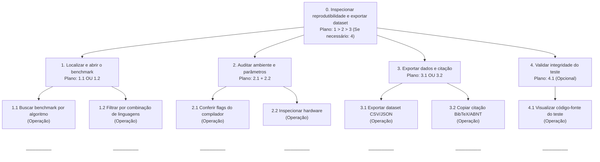
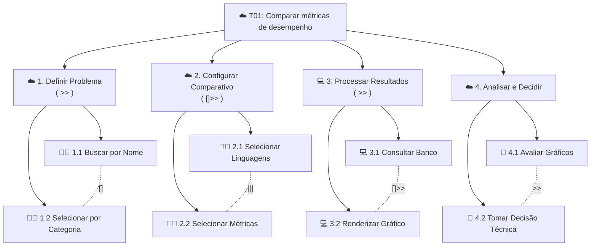
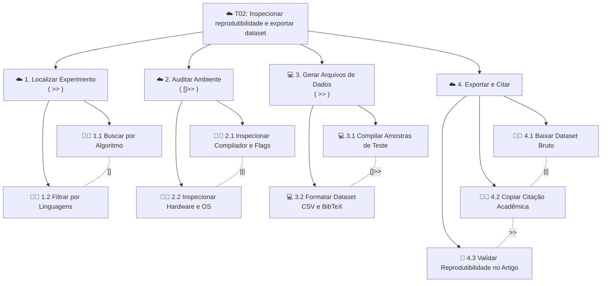

# Entrega 5 — Análise de tarefas: HTA, GOMS e CTT

**Data:** 18/10/2026  
**Status:** 🟩 completa
**Responsabilidade:** Cada integrante modela 1 HTA, 1 GOMS e 1 CTT.

## Objetivo da atividade

Modelar tarefas importantes sob perspectivas complementares: decomposição hierárquica (HTA), estrutura de metas/métodos/operações (GOMS) e relações temporais entre tarefas (CTT). O diagrama deve ser acompanhado de interpretação textual.

## Para projetos cujo TCC não previa interface

Modele **tarefas humanas relacionadas ao uso da contribuição técnica**, e não a implementação interna do algoritmo. Exemplos de boas tarefas para análise:

- investigar uma consulta de baixo desempenho;
- configurar uma análise e selecionar parâmetros;
- submeter um dataset e verificar sua validade;
- acompanhar uma execução demorada;
- comparar dois resultados/modelos;
- interpretar uma recomendação e decidir se a aceita;
- localizar uma execução anterior usando busca/filtros;
- gerar e compartilhar um relatório;
- administrar papéis/permissões quando isso for parte do trabalho real;
- revisar um alerta e registrar uma decisão.

Um CRUD pode gerar tarefas relevantes, mas “cadastrar usuário” só merece modelagem se tiver significado no domínio (papéis, validações, riscos, permissões, dependências).

## Seleção das tarefas

| ID | Tarefa | Persona/cenário de origem | Frequência/criticidade | Autor responsável |
|---|---|---|---|---|
| **T01** | Comparar métricas de desempenho entre linguagens para escolha técnica | P01 (Rafael) / C01 | Alta frequência / Alta criticidade | João Pedro Bazoli Palma |
| **T02** | Inspecionar reprodutibilidade do benchmark e exportar dataset para pesquisa | P02 (Mariana) / C02 | Média-alta frequência / Alta criticidade | Augusto Pereira Teixeira |

> Priorize tarefas necessárias para que o usuário alcance objetivos centrais. Não desperdice a modelagem em ações triviais isoladas, como “clicar em login”, se o objetivo relevante é maior. Da mesma forma, não modele o funcionamento interno do algoritmo como se fosse uma tarefa humana.

---

## HTA — T01 Comparar métricas de desempenho entre linguagens para escolha técnica

**Autor(a):** João Pedro Bazoli Palma — 24.123.041-6

### Descrição da tarefa

- **Objetivo:** Escolher a linguagem ideal para um novo projeto com base em velocidade e uso de memória.
- **Ponto de início:** Acesso à ferramenta de consulta de benchmarks.
- **Conclusão esperada:** Comparativo claro entre linguagens para fundamentar a decisão técnica.
- **Contexto:** Rafael Mendes (P01) precisa definir a linguagem em 2 dias e justificar para a equipe.

### Diagrama

### Decomposição e planos

| **ID** | **Objetivo/operação** | **Plano/ordem** | **Problema ou decisão de design observada** |
| --- | --- | --- | --- |
| **0** | Comparar desempenho entre linguagens para escolha técnica | `1 > 2 > 3`. Se houver dúvida nos dados, faça `4`. | Evitar muitas etapas antes de exibir os resultados. |
| **1** | Selecionar o problema/algoritmo | `1.1 OU 1.2` | Incluir resumos simples dos problemas. |
| **1.1** | Buscar algoritmo por palavra-chave | Operação | Aceitar termos genéricos e sinônimos na busca. |
| **1.2** | Selecionar algoritmo por categoria | Operação | Agrupar por tipo de processamento (ex: memória, CPU). |
| **2** | Selecionar linguagens e métricas | `2.1 + 2.2` | Permitir comparar 2 ou mais linguagens lado a lado. |
| **2.1** | Escolher as linguagens para comparação | Operação | Facilitar a seleção direta na interface. |
| **2.2** | Definir métricas (tempo e memória) | Operação | Exibir ambas as métricas na mesma visualização. |
| **3** | Analisar os resultados | `3.1` | Mostrar a diferença em termos relativos (ex: "2x mais rápida"). |
| **3.1** | Avaliar o ganho relativo de desempenho | Operação | Facilitar a interpretação sem exigir cálculos manuais. |
| **4** | Checar credibilidade do teste | `4.1` (Opcional) | Exibir o computador e o compilador em um clique para dar credibilidade. |
| **4.1** | Conferir especificações do hardware e versões | Operação | Garantir transparência sobre as condições do teste. |

**Verificação do HTA:**

- O objetivo 0 representa uma meta do usuário?
- As subtarefas são necessárias e suficientes?
- Os **planos** indicam ordem, alternativa, repetição ou condição?
- A decomposição parou em nível útil para projeto de interação?

## GOMS — T01 Comparar métricas de desempenho entre linguagens para escolha técnica

**Autor(a):** João Pedro Bazoli Palma — 24.123.041-6

### Goal

#### G0: Comparar métricas de desempenho entre duas ou mais linguagens de programação para fundamentar uma escolha técnica.

#### Métodos, operadores e regras de seleção

#### G1: Selecionar o algoritmo/problema de interesse

* **Method M1.A (Busca direta por palavra-chave):**
  * Identificar algoritmo -> Mover cursor até o campo de busca -> Clicar no campo -> Digitar nome do algoritmo -> Clicar no resultado desejado.
* **Method M1.B (Navegação por categoria de processamento):**
  * Identificar tipo de processamento -> Clicar no menu suspenso de categorias -> Navegar na lista -> Clicar na categoria desejada.
* **Selection Rule SR1:** Usar M1.A quando o gestor souber o nome exato do algoritmo; usar M1.B quando quiser explorar os algoritmos por área de processamento.

#### G2: Selecionar linguagens e gerar confronto direto

* **Method M2.A (Seleção manual via caixas de seleção):**
  * Mover cursor até o painel de linguagens -> Marcar individualmente as linguagens desejadas -> Marcar as métricas (tempo e memória) -> Clicar em "Gerar Comparativo".
* **Method M2.B (Aplicação de preset de comparação rápida):**
  * Mover cursor até o menu "Presets Comparativos" -> Clicar na opção pré-configurada (ex: "Linguagens de Alto Desempenho") -> Clicar em "Aplicar Preset".
* **Selection Rule SR2:** Usar M2.A se o gestor quiser comparar uma combinação específica/personalizada de linguagens; usar M2.B se desejar uma comparação padronizada pré-definida rapidamente.

#### G3: Analisar os resultados e tomar decisão

* **Method M3.A (Análise visual por gráficos de barras lado a lado):**
  * Observar gráfico de velocidade relativa -> Observar gráfico de uso de memória -> Identificar visualmente a linguagem com menor barra de recursos -> Definir a linguagem escolhida.
* **Method M3.B (Análise por tabela quantitativa e ordenação por coluna):**
  * Mover cursor até a aba "Tabela de Dados" -> Clicar no cabeçalho da coluna "Tempo (ms)" para ordenar -> Ler os valores exatos da linguagem líder -> Definir a linguagem escolhida.
* **Selection Rule SR3:** Usar M3.A se o gestor preferir uma visão panorâmica e intuitiva das diferenças relativas; usar M3.B se necessitar dos valores exatos e ordenação precisa para justificar a escolha no relatório.
 
## CTT — T01 Comparar métricas de desempenho entre linguagens para escolha técnica

**Autor(a):** João Pedro Bazoli Palma — 24.123.041-6

### Descrição da tarefa

O gestor Rafael Mendes (P01) acessa a plataforma para escolher e fundamentar a linguagem de programação de um novo projeto. Ele define o algoritmo de interesse, escolhe as linguagens e métricas desejadas, aguarda o processamento do sistema e analisa os gráficos gerados para tomar sua decisão técnica.

### Diagrama

---

### Legenda dos tipos de tarefas

- **[A]** **Tarefa Abstrata (Abstract):** Meta principal que precisa ser decomposta em sub-tarefas.
- **[U]** **Tarefa de Usuário (User):** Ação puramente mental/cognitiva do usuário (análise ou decisão).
- **[I]** **Tarefa de Interação (Interaction):** Ação direta do usuário na interface do sistema.
- **[S]** **Tarefa de Sistema (System):** Processamento automático realizado pelo sistema.

### Legenda dos operadores temporais utilizados

| **Operador** | **Nome da relação** | **Significado na Tarefa T01** |
| --- | --- | --- |
| **&gt;>** | Habilitação (Sequencial) | A conclusão de uma tarefa habilita o início da próxima. |
| **[]>>** | Habilitação com Troca de Informação | A tarefa é concluída e envia parâmetros/dados para a próxima. |
| **[]** | Escolha (Alternativa) | Escolha entre duas ações mutuamente exclusivas. |
| \*\*\` | | |

---

### Estrutura textual da árvore (Decomposição CTT)

- **T01: Comparar métricas de desempenho entre linguagens** **[A]**
  - *Plano temporal principal:* `1. Definir Problema >> 2. Configurar Comparativo []>> 3. Processar Resultados >> 4. Analisar e Decidir`
  - **1. Definir Problema/Algoritmo** **[A]**
    - *Relação:* `1.1 Buscar por Nome [] 1.2 Selecionar por Categoria`
    - **1.1 Buscar por nome** **[I]:** Digitar o termo no campo de busca rápida.
    - **1.2 Selecionar por categoria** **[I]:** Escolher o tipo de processamento no menu suspenso.
  - **2. Configurar Comparativo** **[A]**
    - *Relação:* `2.1 Selecionar Linguagens ||| 2.2 Selecionar Métricas`
    - **2.1 Selecionar linguagens** **[I]:** Escolher as linguagens a serem comparadas.
    - **2.2 Selecionar métricas** **[I]:** Marcar as métricas desejadas (tempo e memória).
  - **3. Processar e Exibir Resultados** **[A]**
    - *Relação:* `3.1 Consultar Banco []>> 3.2 Renderizar Gráfico`
    - **3.1 Consultar banco** **[S]:** O sistema busca os dados de benchmark filtrados.
    - **3.2 Renderizar gráfico** **[S]:** O sistema gera os gráficos comparativos na tela.
  - **4. Analisar e Decidir** **[A]**
    - *Relação:* `4.1 Avaliar Gráficos >> 4.2 Tomar Decisão Técnica`
    - **4.1 Avaliar gráficos** **[U]:** O gestor interpreta a diferença de velocidade e uso de memória.
    - **4.2 Tomar decisão técnica** **[U]:** O gestor define a linguagem escolhida e registra os dados.

---

## HTA — T02 Inspecionar reprodutibilidade do benchmark e exportar dataset para pesquisa

**Autor(a):** Augusto Pereira Teixeira — 24.123.008-5

##### Descrição da tarefa

* **Objetivo:** Inspecionar as condições de execução de um benchmark específico (hardware, versão do compilador e flags de otimização) e exportar o dataset bruto junto com a citação formatada para fundamentar um artigo científico.
* **Ponto de início:** Seleção de um benchmark específico no sistema.
* **Conclusão esperada:** Download do dataset completo (CSV/JSON) com o ambiente auditado e a citação em formato acadêmico (BibTeX/ABNT) copiada.
* **Contexto:** Mariana Costa (P02) precisa garantir que os dados citados no seu artigo sejam 100% reprodutíveis e verificáveis pela comunidade acadêmica.

### Diagrama

### Decomposição e planos

| Objetivo/operação | Plano/ordem | Problema ou decisão de design observada |
|---|---|---|
| **0** Inspecionar reprodutibilidade do benchmark e exportar dataset para pesquisa | Faça 1 > 2 > 3. Se necessário conferir o código original, faça 4. | A falta de transparência sobre compiladores e hardware compromete a reprodutibilidade científica. |
| **1** Localizar e abrir o benchmark do experimento | Faça 1.1 OU 1.2 | Permitir encontrar o teste exato tanto pelo nome do algoritmo quanto pelas linguagens envolvidas. |
| **1.1** Buscar benchmark por algoritmo | Operação | Aceitar nomes de algoritmos e problemas clássicos da literatura. |
| **1.2** Filtrar por combinação de linguagens | Operação | Isolar o experimento exato entre as linguagens analisadas no estudo. |
| **2** Auditar ambiente e parâmetros de execução | Faça (2.1 e 2.2) em qualquer ordem | Exibir flags de otimização e versões de compiladores que influenciam diretamente a variação de desempenho. |
| **2.1** Conferir flags do compilador e versões | Operação | Mostrar detalhadamente versões (ex: GCC vs Clang) e flags de otimização (ex: -O3). |
| **2.2** Inspecionar especificações do hardware | Operação | Apresentar modelo exato da CPU, memória RAM e sistema operacional dos nós de teste. |
| **3** Exportar dados brutos e citação acadêmica | Faça 3.1 OU 3.2 (ou ambos) | Facilitar a inclusão de dados brutos na metodologia do artigo e a citação nas referências. |
| **3.1** Exportar dataset bruto em CSV ou JSON | Operação | Permitir baixar as amostras temporais brutas para análise estatística própria (ex: R, Python). |
| **3.2** Copiar referência formatada em BibTeX ou ABNT | Operação | Oferecer botão de cópia de citação em um clique nos formatos padrão da academia. |
| **4** Validar integridade e reprodutibilidade | 4.1 (Opcional) | Permitir que o pesquisador confira o script de automação e o código-fonte usado no benchmark. |
| **4.1** Visualizar código-fonte e script do teste | Operação | Exibir o repositório ou código do teste diretamente em modal/aba dedicada. |

## GOMS — T02 Inspecionar reprodutibilidade do benchmark e exportar dataset para pesquisa

**Autor(a):** Augusto Pereira Teixeira — 24.123.008-5

### Goal

#### G0: Auditar a reprodutibilidade do ambiente de testes e extrair dataset bruto e citação para artigo acadêmico.

#### Métodos, operadores e regras de seleção

#### G1: Localizar o benchmark do experimento

* **Method M1.A (Busca direta por algoritmo):**
  * Identificar algoritmo -> Digitar nome técnico no campo de busca -> Clicar no experimento correspondente.
* **Method M1.B (Filtro por combinação de linguagens):**
  * Mover cursor até o filtro de linguagens -> Selecionar o par de linguagens do estudo -> Clicar em "Filtrar Experimentos" -> Selecionar o benchmark da lista.
* **Selection Rule SR1:** Usar M1.A quando o objetivo for um algoritmo específico; usar M1.B quando o foco for analisar a competição entre duas linguagens em múltiplos cenários.

#### G2: Inspecionar e auditar o ambiente de testes

* **Method M2.A (Inspeção visual por abas de detalhes do painel):**
  * Clicar na aba "Versão do Compilador e Flags" -> Ler parâmetros de compilação (ex: -O3, GCC 13.2) -> Clicar na aba "Especificações de Hardware" -> Ler modelo de CPU, RAM e sistema operacional.
* **Method M2.B (Visualização do manifesto/script YAML de execução):**
  * Clicar no botão "Ver Manifesto do Teste (YAML/JSON)" -> Rolar pela janela de código -> Inspecionar as configurações de hardware, ambiente e flags unificadas no arquivo de manifesto.
* **Selection Rule SR2:** Usar M2.A para uma conferência rápida dos metadados de ambiente organizados por seções; usar M2.B quando for necessário validar a especificação técnica completa do script de execução para garantir a reprodutibilidade exata.

#### G3: Exportar dados brutos e citação acadêmica

* **Method M3.A (Exportação via botões da interface):**
  * Clicar no botão "Exportar Dataset" -> Selecionar formato (CSV ou JSON) -> Confirmar download -> Clicar no botão "Citar Benchmark" -> Selecionar formato (BibTeX ou ABNT) -> Clicar em "Copiar Citação".
* **Method M3.B (Geração de pacote completo de reprodutibilidade em ZIP):**
  * Clicar no botão "Baixar Pacote de Reprodutibilidade (.zip)" -> Confirmar download contendo dataset em CSV, manifesto YAML do ambiente e arquivo de citação citation.bib.
* **Selection Rule SR3:** Usar M3.A para extrair separadamente os dados brutos ou a citação conforme a necessidade pontual da escrita; usar M3.B para obter todos os artefatos de reprodutibilidade empacotados de uma só vez para anexar ao repositório do artigo.

## CTT — T02 Buscar e comparar métricas para pesquisa acadêmica

Autor(a): Augusto Pereira Teixeira — 24.123.008-5

### Descrição da tarefa

Mariana Costa (P02) acessa a plataforma para auditar um benchmark e extrair evidências para seu artigo. Ela localiza o experimento, inspeciona o ambiente técnico (hardware, compilador e flags), solicita ao sistema a geração do arquivo de dados brutos e copia a citação acadêmica no padrão BibTeX/ABNT.

### Diagrama

### Legenda dos operadores temporais utilizados

| **Operador** | **Nome da relação** | **Significado na Tarefa T02** |
|---|---|---|
| **>>** | Habilitação (Sequencial) | A conclusão de uma etapa habilita o início da seguinte. |
| **[]>>** | Habilitação com Troca de Informação | A auditoria do ambiente conclui e fornece contexto para a geração do dataset. |
| **[]** | Escolha (Alternativa) | Escolha entre buscar por nome de algoritmo ou filtrar por linguagens. |
| **\|\|\|** | Concorrência (Paralelo) | As operações podem ser executadas de forma independente. |

### Estrutura textual da árvore (Decomposição CTT)

* **T02: Inspecionar reprodutibilidade e exportar dataset** **[A]**
  * *Plano temporal principal:* 1. Localizar Experimento >> 2. Auditar Ambiente []>> 3. Gerar Arquivos de Dados >> 4. Exportar e Citar
  * **1. Localizar Experimento** **[A]**
    * *Relação:* 1.1 Buscar por Algoritmo [] 1.2 Filtrar por Linguagens
    * **1.1 Buscar por algoritmo** **[I]:** Digitar o nome do algoritmo no campo de busca.
    * **1.2 Filtrar por linguagens** **[I]:** Selecionar o par de linguagens do estudo.
  * **2. Auditar Ambiente de Teste** **[A]**
    * *Relação:* 2.1 Inspecionar Compilador e Flags ||| 2.2 Inspecionar Hardware e OS
    * **2.1 Inspecionar compilador e flags** **[I]:** Checar versão exata (ex: GCC 13.2) e parâmetros de otimização (`-O3`).
    * **2.2 Inspecionar hardware e OS** **[I]:** Conferir modelo da CPU, memória e sistema operacional.
  * **3. Gerar Arquivos e Formatação** **[A]**
    * *Relação:* 3.1 Compilar Amostras de Teste []>> 3.2 Formatar Dataset CSV e BibTeX
    * **3.1 Compilar amostras de teste** **[S]:** O sistema consolida as medições brutas do experimento.
    * **3.2 Formatar dataset e citação** **[S]:** O sistema gera o arquivo CSV e a entrada BibTeX/ABNT.
  * **4. Exportar e Citar** **[A]**
    * *Relação:* (4.1 Baixar Dataset ||| 4.2 Copiar Citação) >> 4.3 Validar Reprodutibilidade no Artigo
    * **4.1 Baixar dataset bruto** **[I]:** Efetuar o download do arquivo CSV/JSON.
    * **4.2 Copiar citação acadêmica** **[I]:** Clicar no botão de cópia da referência BibTeX/ABNT.
    * **4.3 Validar reprodutibilidade no artigo** **[U]:** Mariana confirma a integridade dos dados para inclusão na metodologia do seu estudo.

      
## Síntese da equipe

A modelagem das tarefas T01 e T02 identificou requisitos essenciais para a interface, como gráficos comparativos, busca por algoritmos e transparência sobre o ambiente dos testes e a estrutura dos algoritimos codificados. Ambas serão incluídas no protótipo e avaliadas nos testes de usabilidade.Quais problemas de interação, oportunidades e requisitos apareceram a partir das modelagens? Quais tarefas irão para o protótipo e para o teste de usabilidade?

## Checklist

- [x] Cada integrante produziu ao menos 1 HTA, 1 GOMS e 1 CTT.
- [x] Cada artefato identifica autor e tarefa.
- [x] Diagramas são legíveis e possuem fonte editável quando possível.
- [x] HTA contém planos, não apenas árvore de tópicos.
- [x] GOMS distingue Goals, Operators, Methods e Selection Rules.
- [x] CTT usa operadores temporais e tipos de tarefa coerentes.
- [x] Há texto explicando cada diagrama.
- [x] Tarefas estão ligadas a cenários/personas na rastreabilidade.
- [x] Em TCC técnico, as tarefas descrevem o que a pessoa faz com a contribuição/resultados, não passos internos do código.
- [x] CRUDs, relatórios, filtros e atividades administrativas foram escolhidos por relevância ao objetivo do usuário.
