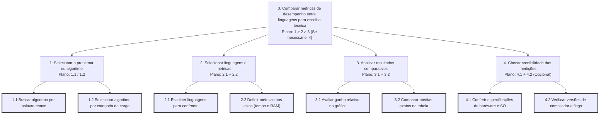
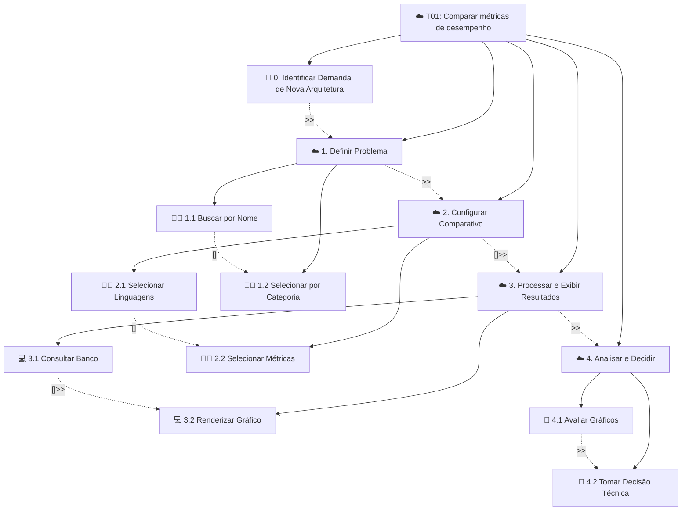
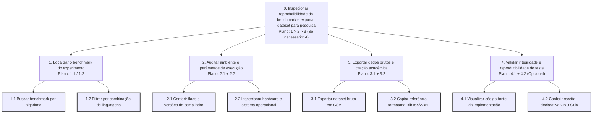
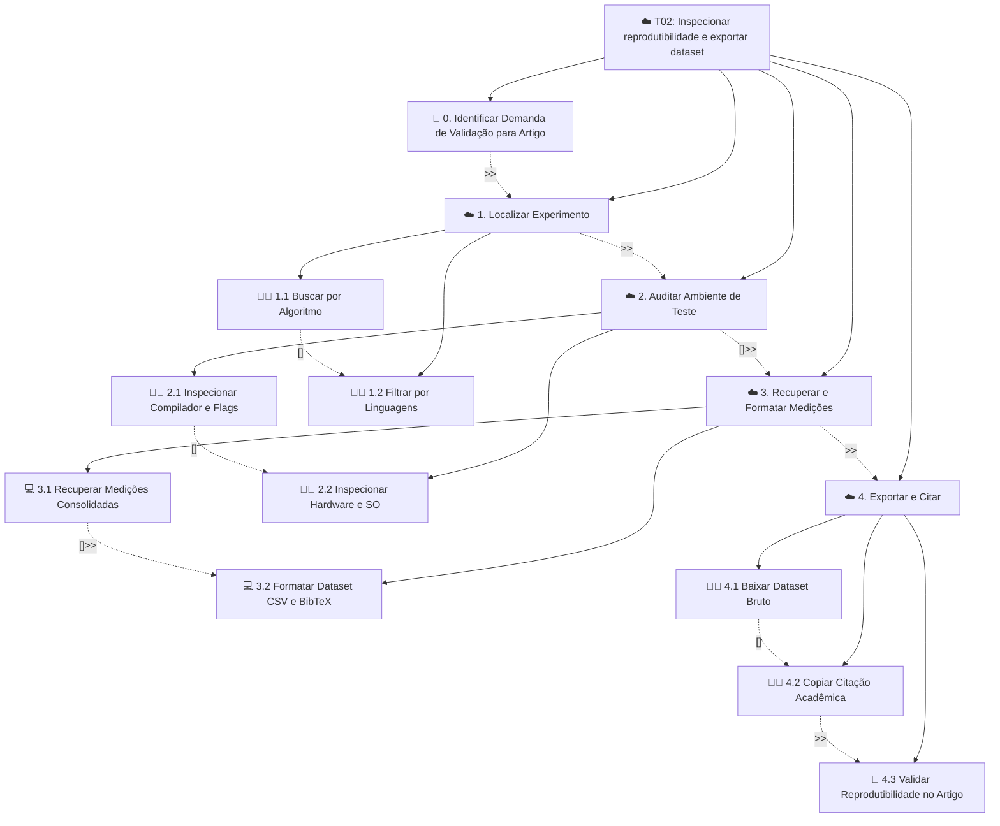

### Entrega 5 — Análise de tarefas: HTA, GOMS e CTT

**Data:** 18/10/2026 (Revisado em 23/11/2026)

**Status:** 🟩 completa

**Responsabilidade:** Cada integrante modela 1 HTA, 1 GOMS e 1 CTT.

#### Objetivo da atividade

Modelar tarefas importantes sob perspectivas complementares: decomposição hierárquica (HTA), estrutura de metas/métodos/operações (GOMS) e relações temporais entre tarefas (CTT). O diagrama deve ser acompanhado de interpretação textual.

#### Para projetos cujo TCC não previa interface

Modele tarefas humanas relacionadas ao uso da contribuição técnica, e não a implementação interna do algoritmo. Exemplos de boas tarefas para análise:

* investigar uma consulta de baixo desempenho;
* configurar uma análise e selecionar parâmetros;
* submeter um dataset e verificar sua validade;
* acompanhar uma execução demorada;
* comparar dois resultados/modelos;
* interpretar uma recomendação e decidir se a aceita;
* localizar uma execução anterior usando busca/filtros;
* gerar e compartilhar um relatório;
* administrar papéis/permissões quando isso for parte do trabalho real;
* revisar um alerta e registrar uma decisão.

#### Seleção das tarefas

| ID | Tarefa | Persona/cenário de origem | Frequência/criticidade | Autor responsável |
| ------ | ------ | ------ | ------ | ------ |
| **T01** | Comparar métricas de desempenho entre linguagens para escolha técnica | P01 (Rafael) / C01 | Alta frequência / Alta criticidade | João Pedro Bazoli Palma |
| **T02** | Inspecionar reprodutibilidade do benchmark e exportar dataset para pesquisa | P02 (Mariana) / C02 | Média-alta frequência / Alta criticidade | Augusto Pereira Teixeira |

--------------------------------------------------------------------------------

#### HTA — T01 Comparar métricas de desempenho entre linguagens para escolha técnica

**Autor(a):** João Pedro Bazoli Palma — 24.123.041-6

##### Descrição da tarefa

* **Objetivo:** Escolher a linguagem ideal para um novo projeto com base no trade-off de velocidade de execução e uso de memória RAM.
* **Ponto de início:** Acesso à ferramenta de consulta de benchmarks.
* **Conclusão esperada:** Comparativo claro e fundamentado entre as linguagens candidatas.
* **Contexto:** Rafael Mendes (P01) precisa definir e justificar tecnicamente a escolha de arquitetura em prazo curto.

##### Diagrama

##### Decomposição e planos

| **ID** | **Objetivo/operação** | **Plano/ordem** | **Problema ou decisão de design observada** |
| ------ | ------ | ------ | ------ |
| **0** | **Comparar desempenho entre linguagens para escolha técnica** | **Input:** Demanda de definição tecnológica para novo projeto de software. **Feedback:** Decisão técnica fundamentada a partir do comparativo exibido. **Plano:** 1 > 2 > 3 (Se houver dúvida metodológica, faça 4). | Evitar sobrecarga cognitiva e exibir o comparativo sem etapas desnecessárias. |
| **1** | Selecionar o problema/algoritmo | 1.1 / 1.2 | Permitir encontrar o teste tanto por busca direta quanto por tipo de processamento. |
| **1.1** | Buscar algoritmo por palavra-chave | Operação terminal | Caixa de busca com suporte a termos usuais (ex: MergeSort). |
| **1.2** | Selecionar algoritmo por categoria de carga | Operação terminal | Agrupar benchmarks por perfil (CPU-bound vs Memory-bound). |
| **2** | Selecionar linguagens e métricas | 2.1 + 2.2 | Permitir comparar duas ou mais opções na mesma visualização. |
| **2.1** | Escolher as linguagens para confronto | Operação terminal | Facilitar seleção e desmarcação rápida via checkboxes na tabela. |
| **2.2** | Definir métricas nos eixos (tempo e RAM) | Operação terminal | Seletores dedicados para eixos X e Y com suporte a escala logarítmica. |
| **3** | Analisar os resultados | 3.1 + 3.2 | Integrar visão panorâmica gráfica com conferência numérica detalhada. |
| **3.1** | Avaliar ganho relativo no gráfico | Operação terminal | Identificação imediata da dispersão e do trade-off no gráfico cartesiano. |
| **3.2** | Comparar médias exatas na tabela | Operação terminal | Leitura de médias aritméticas e desvios para embasar relatório técnico. |
| **4** | Checar credibilidade das medições | 4.1 + 4.2 (Opcional) | Oferecer transparência completa das condições físicas de teste. |
| **4.1** | Conferir especificações de hardware e SO | Operação terminal | Consulta ao modelo de processador e total de memória instalada via menu About. |
| **4.2** | Verificar versões de compilador e flags | Operação terminal | Inspeção dos parâmetros de otimização (-O3) para assegurar paridade de teste. |

--------------------------------------------------------------------------------

#### GOMS — T01 Comparar métricas de desempenho entre linguagens para escolha técnica

**Autor(a):** João Pedro Bazoli Palma — 24.123.041-6

##### Estrutura de Metas, Métodos, Operadores e Regras de Seleção

###### GOAL 0: Comparar métricas de desempenho entre linguagens para fundamentar escolha técnica

* **GOAL 1: Selecionar o algoritmo de interesse no catálogo**
  * **METHOD 1.A: Busca direta por palavra-chave**
    * OP. 1.A.1: Identificar mentalmente o nome do algoritmo desejado
    * OP. 1.A.2: Mover o cursor até o campo de busca rápida
    * OP. 1.A.3: Clicar no campo de busca
    * OP. 1.A.4: Digitar o nome do algoritmo
    * OP. 1.A.5: Clicar no card do benchmark retornado
    * OP. 1.A.6: Verificar visualmente se a página do benchmark selecionado foi carregada
  * **METHOD 1.B: Navegação por perfil de carga**
    * OP. 1.B.1: Identificar mentalmente o perfil de gargalo (CPU-bound vs Memory-bound)
    * OP. 1.B.2: Mover o cursor até o botão de filtro de categoria
    * OP. 1.B.3: Clicar no perfil de carga desejado
    * OP. 1.B.4: Clicar no card do algoritmo correspondente na lista filtrada
    * OP. 1.B.5: Verificar visualmente se a página do algoritmo foi carregada
  * **SELECTION RULE 1:** Usar METHOD 1.A se o gestor já souber o algoritmo exato; usar METHOD 1.B para explorar opções por perfil de recurso.
* **GOAL 2: Selecionar linguagens e ajustar parâmetros de visualização**
  * **METHOD 2.A: Filtragem por checkboxes na tabela**
    * OP. 2.A.1: Rolar a página até a tabela de séries
    * OP. 2.A.2: Desmarcar checkboxes das linguagens secundárias
    * OP. 2.A.3: Manter marcadas apenas as linguagens candidatas (ex: C e Rust)
    * OP. 2.A.4: Verificar visualmente se os pontos das demais linguagens foram ocultados no gráfico
  * **METHOD 2.B: Ajuste de escala logarítmica**
    * OP. 2.B.1: Observar eventual sobreposição de pontos em escala linear
    * OP. 2.B.2: Mover o cursor até o controle Log Y
    * OP. 2.B.3: Clicar no botão toggle para ativar escala logarítmica
    * OP. 2.B.4: Verificar visualmente se a dispersão das séries tornou-se legível
  * **SELECTION RULE 2:** Usar METHOD 2.A para isolar linguagens específicas; usar METHOD 2.B quando houver grande disparidade de grandeza numérica entre métricas.
* **GOAL 3: Analisar os resultados e consolidar decisão técnica**
  * **METHOD 3.A: Análise visual pelo gráfico de dispersão**
    * OP. 3.A.1: Observar a posição relativa dos pontos no plano cartesiano
    * OP. 3.A.2: Identificar a linguagem localizada na região ótima (menor tempo e menor memória)
    * OP. 3.A.3: Definir mentalmente a tecnologia escolhida
    * OP. 3.A.4: Verificar se o trade-off atende aos requisitos arquiteturais do projeto
  * **METHOD 3.B: Análise quantitativa ordenada pela tabela de médias**
    * OP. 3.B.1: Mover o cursor até o cabeçalho da coluna de tempo médio
    * OP. 3.B.2: Clicar no cabeçalho para ordenar as linguagens em ordem crescente
    * OP. 3.B.3: Ler os valores exatos de tempo e memória da primeira colocada
    * OP. 3.B.4: Definir mentalmente a tecnologia escolhida
    * OP. 3.B.5: Verificar se a diferença numérica oferece segurança suficiente para justificar o relatório
  * **SELECTION RULE 3:** Usar METHOD 3.A para identificação rápida de trade-off; usar METHOD 3.B para extrair valores exatos para documentação técnica.

--------------------------------------------------------------------------------

#### CTT — T01 Comparar métricas de desempenho entre linguagens para escolha técnica

**Autor(a):** João Pedro Bazoli Palma — 24.123.041-6

##### Descrição da tarefa

O gestor Rafael Mendes (P01) é motivado por uma demanda de definição técnica de um novo serviço. Ele acessa a plataforma, escolhe o algoritmo de teste, define as linguagens e parâmetros nos eixos, aguarda a consulta e renderização gráfica pelo sistema e interpreta os resultados para definir a linguagem adotada.

##### Diagrama

##### Legenda dos operadores temporais utilizados

| **Operador** | **Nome da relação** | **Significado na Tarefa T01** |
| ------ | ------ | ------ |
| **>>** | Habilitação (Sequencial) | A conclusão de uma etapa habilita o início da seguinte. |
| **[]>>** | Habilitação com Troca de Informação | A tarefa é concluída e passa parâmetros/dados para a seguinte. |
| **[]** | Escolha (Alternativa) | Escolha entre ações mutuamente exclusivas ou executáveis em qualquer ordem. |
| **\|\|\|** | Concorrência | Ações que podem ser processadas simultaneamente. |

##### Estrutura textual da árvore (Decomposição CTT)

* **T01: Comparar métricas de desempenho entre linguagens [A]**
  * *Plano temporal principal:* 0. Identificar Demanda >> 1. Definir Problema >> 2. Configurar Comparativo []>> 3. Processar Resultados >> 4. Analisar e Decidir
* **0. Identificar demanda de nova arquitetura [U]:** Motivação externa que leva o profissional a buscar dados para decisão técnica.
* **1. Definir Problema/Algoritmo [A]**
  * *Relação:* 1.1 Buscar por Nome [] 1.2 Selecionar por Categoria
  * **1.1 Buscar por nome [I]:** Digitar o termo no campo de busca rápida.
  * **1.2 Selecionar por categoria [I]:** Escolher o tipo de processamento nos filtros do catálogo.
* **2. Configurar Comparativo [A]**
  * *Relação:* 2.1 Selecionar Linguagens [] 2.2 Selecionar Métricas
  * **2.1 Selecionar linguagens [I]:** Marcar/desmarcar séries na tabela de dados.
  * **2.2 Selecionar métricas [I]:** Ajustar seletores de eixos e alternar escala logarítmica.
* **3. Processar e Exibir Resultados [A]**
  * *Relação:* 3.1 Consultar Banco []>> 3.2 Renderizar Gráfico
  * **3.1 Consultar banco [S]:** O sistema recupera as medições consolidadas do benchmark.
  * **3.2 Renderizar gráfico [S]:** O sistema gera visualmente a dispersão cartesiana e a tabela sumarizada.
* **4. Analisar e Decidir [A]**
  * *Relação:* 4.1 Avaliar Gráficos >> 4.2 Tomar Decisão Técnica
  * **4.1 Avaliar gráficos [U]:** O gestor interpreta a relação de velocidade vs. consumo de memória.
  * **4.2 Tomar decisão técnica [U]:** O gestor define a tecnologia aprovada e registra sua fundamentação.

--------------------------------------------------------------------------------

#### HTA — T02 Inspecionar reprodutibilidade do benchmark e exportar dataset para pesquisa

**Autor(a):** Augusto Pereira Teixeira — 24.123.008-5

##### Descrição da tarefa

* **Objetivo:** Inspecionar as condições de execução de um benchmark (hardware, compilador e flags) e exportar o dataset bruto junto à citação acadêmica.
* **Ponto de início:** Seleção de um benchmark específico na plataforma.
* **Conclusão esperada:** Download do dataset (CSV) com o ambiente experimental auditado e citação formatada copiada.
* **Contexto:** Mariana Costa (P02) necessita garantir total reprodutibilidade dos dados para submissão de artigo científico.

##### Diagrama

##### Decomposição e planos

| **ID** | **Objetivo/operação** | **Plano/ordem** | **Problema ou decisão de design observada** |
| ------ | ------ | ------ | ------ |
| **0** | **Inspecionar reprodutibilidade do benchmark e exportar dataset para pesquisa** | **Input:** Elaboração de artigo acadêmico demandando dados experimentais verificáveis. **Feedback:** Dataset bruto em CSV exportado e citação formatada copiada, com o ambiente auditado. **Plano:** 1 > 2 > 3 (Se necessário conferir código/automação, faça 4). | A omissão de compiladores e hardware compromete a reprodutibilidade científica. |
| **1** | Localizar e abrir o benchmark do experimento | 1.1 / 1.2 | Permitir encontrar o experimento tanto por nome de algoritmo quanto pelas linguagens envolvidas. |
| **1.1** | Buscar benchmark por algoritmo | Operação terminal | Aceitar busca textual direta por algoritmos clássicos da literatura. |
| **1.2** | Filtrar por combinação de linguagens | Operação terminal | Filtrar experimentos que contenham o par exato de linguagens sob estudo. |
| **2** | Auditar ambiente e parâmetros de execução | 2.1 + 2.2 | Exibir flags de otimização e parâmetros de máquina que impactam os resultados. |
| **2.1** | Conferir flags e versões do compilador | Operação terminal | Exibir versões de ferramentas e flags de compilação (-O3, .ReleaseFast). |
| **2.2** | Inspecionar hardware e sistema operacional | Operação terminal | Apresentar processador (Ryzen 5 3600), memória RAM e versão do Kernel Linux. |
| **3** | Exportar dados brutos e citação acadêmica | 3.1 + 3.2 | Permitir tanto a extração de dados quanto a correta referenciação do benchmark. |
| **3.1** | Exportar dataset bruto em CSV | Operação terminal | Download direto do arquivo CSV consolidado para análise estatística externa (R/Python). |
| **3.2** | Copiar referência formatada BibTeX/ABNT | Operação terminal | Botão com feedback instantâneo para transferência da citação para a área de transferência. |
| **4** | Validar integridade e reprodutibilidade do teste | 4.1 + 4.2 (Opcional) | Permitir conferência aprofundada dos arquivos de implementação e automação. |
| **4.1** | Visualizar código-fonte da implementação | Operação terminal | Exibição do código (main.zig) para verificação de paridade algorítmica. |
| **4.2** | Conferir receita declarativa GNU Guix | Operação terminal | Visualização e cópia do manifesto declarativo para replicação em contêiner determinístico. |

--------------------------------------------------------------------------------

#### GOMS — T02 Inspecionar reprodutibilidade do benchmark e exportar dataset para pesquisa

**Autor(a):** Augusto Pereira Teixeira — 24.123.008-5

##### Estrutura de Metas, Métodos, Operadores e Regras de Seleção

###### GOAL 0: Inspecionar reprodutibilidade do ambiente de testes e extrair dataset e citação para pesquisa

* **GOAL 1: Localizar o benchmark do experimento**
  * **METHOD 1.A: Busca direta por algoritmo**
    * OP. 1.A.1: Identificar mentalmente o algoritmo estudado
    * OP. 1.A.2: Mover o cursor até a barra de busca
    * OP. 1.A.3: Digitar o nome do algoritmo
    * OP. 1.A.4: Clicar no experimento correspondente
    * OP. 1.A.5: Verificar visualmente se a página do experimento correto foi carregada
  * **METHOD 1.B: Navegação pelo catálogo de benchmarks**
    * OP. 1.B.1: Rolar pela grade de cards disponíveis
    * OP. 1.B.2: Localizar visualmente o card com o par de linguagens e algoritmo
    * OP. 1.B.3: Clicar no card do benchmark
    * OP. 1.B.4: Verificar visualmente se os dados abertos correspondem ao experimento desejado
  * **SELECTION RULE 1:** Usar METHOD 1.A quando souber o algoritmo de interesse; usar METHOD 1.B para exploração sequencial.
* **GOAL 2: Inspecionar e auditar o ambiente de testes**
  * **METHOD 2.A: Consulta de infraestrutura física via About**
    * OP. 2.A.1: Mover o cursor até o botão "About" no menu superior
    * OP. 2.A.2: Clicar no botão "About"
    * OP. 2.A.3: Ler especificações de CPU (AMD Ryzen 5 3600), memória RAM (32GB) e Kernel
    * OP. 2.A.4: Clicar no link "Back to benchmarks" para retornar à análise
    * OP. 2.A.5: Verificar se as especificações de hardware são suficientes para reporte no artigo
  * **METHOD 2.B: Auditoria de parâmetros de compilação e código**
    * OP. 2.B.1: Clicar na aba de arquivos técnicos do benchmark
    * OP. 2.B.2: Selecionar o arquivo de configuração (build.zig)
    * OP. 2.B.3: Ler as flags de otimização aplicadas (-O3)
    * OP. 2.B.4: Selecionar o código-fonte (main.zig) para checagem de paridade
    * OP. 2.B.5: Verificar se as implementações utilizam a mesma complexidade algorítmica
  * **SELECTION RULE 2:** Usar METHOD 2.A para conferir a máquina física; usar METHOD 2.B para auditar parâmetros de compilação e paridade de código.
* **GOAL 3: Exportar dados brutos e citação acadêmica**
  * **METHOD 3.A: Download do dataset e cópia da citação**
    * OP. 3.A.1: Mover o cursor até o link de download do dataset (MergeSort.csv)
    * OP. 3.A.2: Clicar no link para baixar o arquivo
    * OP. 3.A.3: Mover o cursor até a seção de citação
    * OP. 3.A.4: Clicar no botão "Copy" para copiar a entrada BibTeX
    * OP. 3.A.5: Verificar se o download foi concluído e se o feedback visual de cópia foi exibido
  * **METHOD 3.B: Cópia da receita reprodutível GNU Guix**
    * OP. 3.B.1: Navegar até a aba de reprodutibilidade experimental
    * OP. 3.B.2: Localizar o bloco de comando do script de contêiner (setup.sh)
    * OP. 3.B.3: Clicar no botão "Copy" ao lado do comando guix time-machine
    * OP. 3.B.4: Verificar se a confirmação de cópia no clipboard foi exibida com sucesso
  * **SELECTION RULE 3:** Usar METHOD 3.A para obter dados para análise e escrita direta; usar METHOD 3.B para replicar a infraestrutura de medição em máquina local.

--------------------------------------------------------------------------------

#### CTT — T02 Inspecionar reprodutibilidade do benchmark e exportar dataset para pesquisa

**Autor(a):** Augusto Pereira Teixeira — 24.123.008-5

##### Descrição da tarefa

Mariana Costa (P02) é motivada pela necessidade de auditar e comprovar o rigor de dados empíricos antes de citá-los em sua tese. Ela acessa o sistema, localiza o benchmark, audita os dados de hardware e compilador, solicita ao sistema a recuperação das medições consolidadas e copia o arquivo CSV e a citação acadêmica.

##### Diagrama

##### Legenda dos operadores temporais utilizados

| **Operador** | **Nome da relação** | **Significado na Tarefa T02** |
| ------ | ------ | ------ |
| **>>** | Habilitação (Sequencial) | A conclusão de uma etapa habilita o início da seguinte. |
| **[]>>** | Habilitação com Troca de Informação | A auditoria do ambiente conclui e fornece contexto para a recuperação dos dados. |
| **[]** | Escolha (Alternativa) | Escolha entre ações mutuamente exclusivas ou executáveis em qualquer ordem. |
| **\|\|\|** | Concorrência | Ações que podem ser processadas simultaneamente. |

##### Estrutura textual da árvore (Decomposição CTT)

* **T02: Inspecionar reprodutibilidade e exportar dataset [A]**
  * *Plano temporal principal:* 0. Identificar Demanda >> 1. Localizar Experimento >> 2. Auditar Ambiente []>> 3. Recuperar e Formatar Medições >> 4. Exportar e Citar
* **0. Identificar demanda de validação para artigo [U]:** Necessidade externa de comprovação de rigor metodológico antes de citar resultados em publicação acadêmica.
* **1. Localizar Experimento [A]**
  * *Relação:* 1.1 Buscar por Algoritmo [] 1.2 Filtrar por Linguagens
  * **1.1 Buscar por algoritmo [I]:** Digitar o nome do algoritmo no campo de busca.
  * **1.2 Filtrar por linguagens [I]:** Selecionar o par de linguagens de interesse na navegação.
* **2. Auditar Ambiente de Teste [A]**
  * *Relação:* 2.1 Inspecionar Compilador e Flags [] 2.2 Inspecionar Hardware e SO
  * **2.1 Inspecionar compilador e flags [I]:** Checar versão de compilador e flags de otimização (-O3).
  * **2.2 Inspecionar hardware e SO [I]:** Conferir especificações de CPU, memória RAM e kernel via About.
* **3. Recuperar e Formatar Medições [A]**
  * *Relação:* 3.1 Recuperar Medições Consolidadas []>> 3.2 Formatar Dataset CSV e BibTeX
  * **3.1 Recuperar medições consolidadas [S]:** O sistema busca a base pré-processada de testes homologados.
  * **3.2 Formatar dataset e citação [S]:** O sistema disponibiliza o link para o arquivo CSV e a string BibTeX formatada.
* **4. Exportar e Citar [A]**
  * *Relação:* (4.1 Baixar Dataset [] 4.2 Copiar Citação) >> 4.3 Validar Reprodutibilidade no Artigo
  * **4.1 Baixar dataset bruto [I]:** Download do arquivo tabular CSV com as amostras.
  * **4.2 Copiar citação acadêmica [I]:** Clicar no botão de cópia com confirmação imediata.
  * **4.3 Validar reprodutibilidade no artigo [U]:** Mariana atesta a confiabilidade do experimento e inclui a refer
