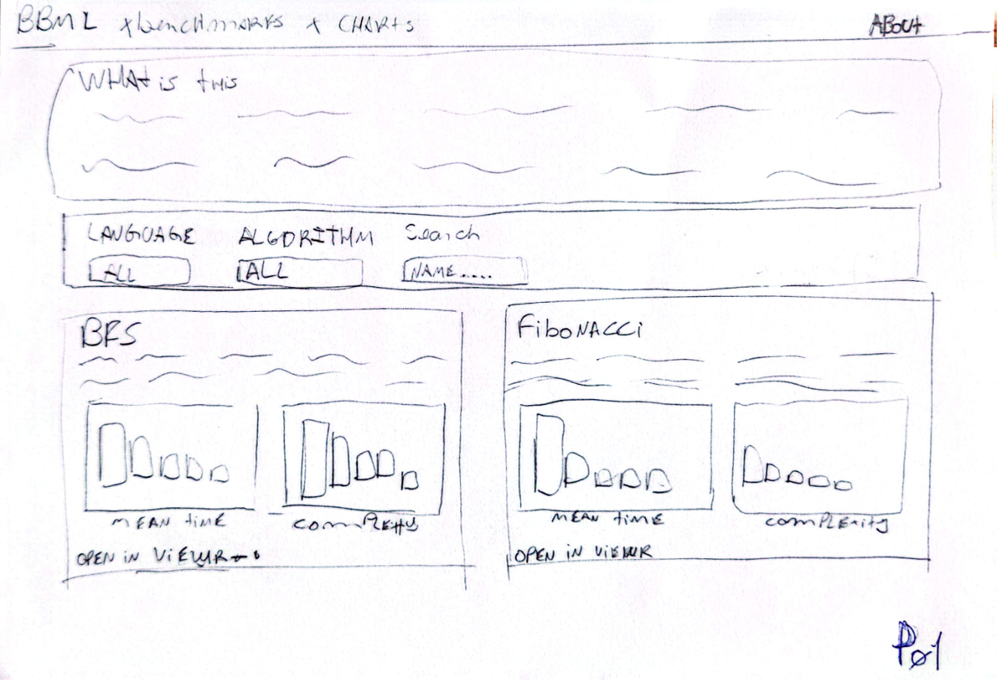
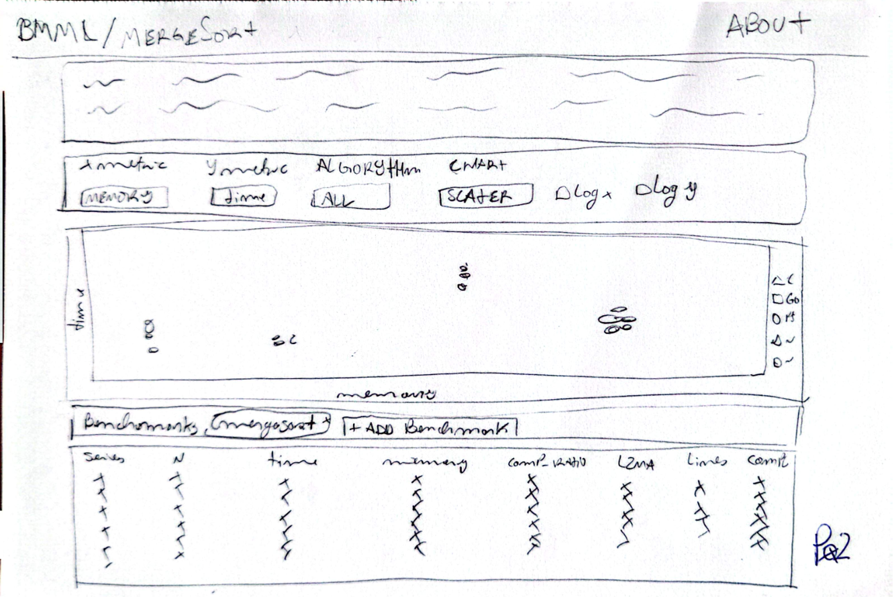
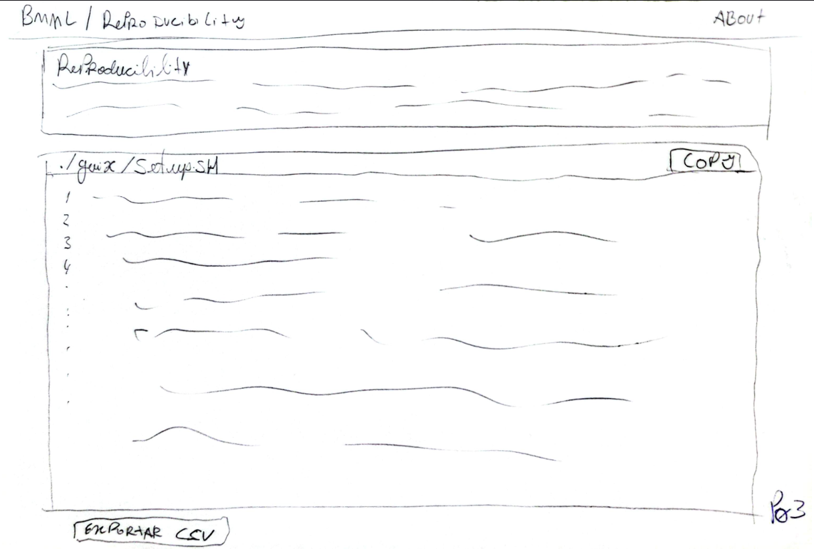
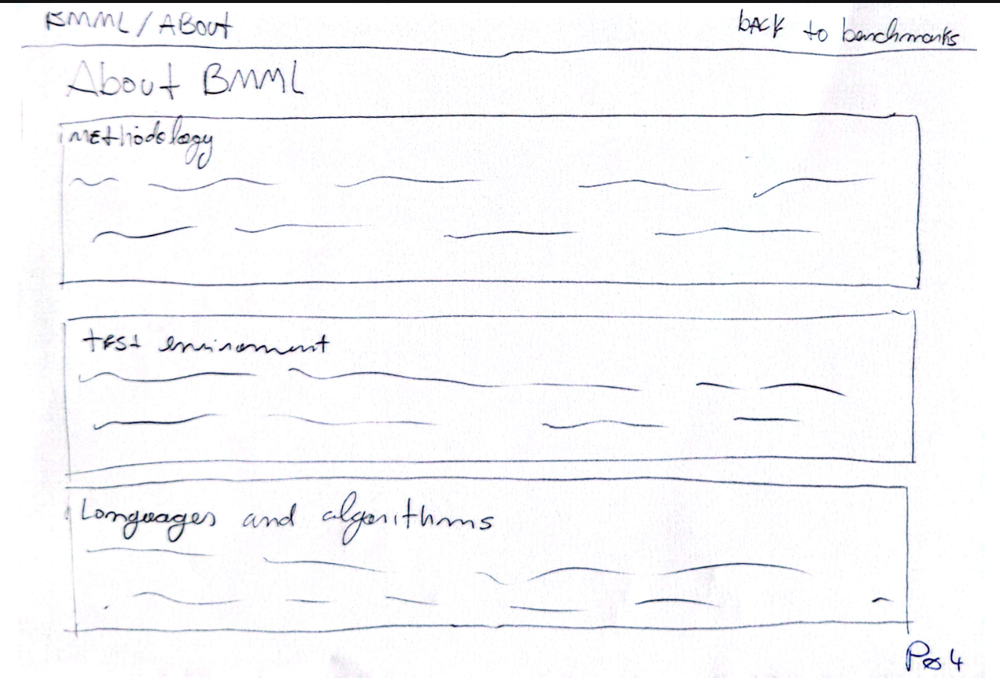

### Entrega 6 — Prototipação em papel

**Data:** 06/11/2026

**Status:** 🟩 completa

**Responsabilidade:** João Pedro Bazoli Palma e Augusto Pereira Teixeira

#### Objetivo da atividade

Externalizar rapidamente ideias de interação em baixa fidelidade para explorar alternativas antes de investir em detalhes visuais. O valor está no ciclo **construir → simular → observar → revisar**, não na beleza do desenho.

#### 1. Escopo do protótipo

* **Personas:**
  * **P01 (Rafael Mendes):** Gestor Técnico (decisões céleres de arquitetura/linguagem com base em comparação de velocidade e memória).
  * **P02 (Mariana Costa):** Pesquisadora Acadêmica (auditar reprodutibilidade, conferir códigos/parâmetros e comandos de execução da bancada de testes).
* **Cenários/tarefas cobertos:**
  * **C01 / T01:** Comparar métricas de desempenho entre linguagens para escolha técnica.
  * **C02 / T02:** Inspecionar reprodutibilidade do benchmark e auditar especificações do ambiente experimental.
* **Objetivos principais:**
  * Localização rápida de benchmarks via catálogo filtrável na página inicial.
  * Comparação visual e parametrizada de desempenho entre linguagens na tela do algoritmo via gráfico cartesiano de dispersão.
  * Transparência técnica total: inspeção do código-fonte, comandos de build/run via GNU Guix (com botão de cópia direta) e especificações do ambiente de hardware.

##### 1.1 Famílias de interface escolhidas

Com base nas tarefas priorizadas para P01 e P02, o protótipo explora três famílias:

1. **Catálogo & Dashboard de Entrada:** introdução à plataforma, busca e filtragem (nome, categoria, linguagens) e lista de benchmarks com resumos visuais de métricas.
2. **Painel de Comparação & Parametrização:** descrição do algoritmo e configuração da comparação entre linguagens, alternando parâmetros e métricas no gráfico cartesiano de dispersão (tempo vs. memória e escalas lineares/logarítmicas).
3. **Inspeção, Auditoria & Reprodutibilidade:** código-fonte, receita declarativa via GNU Guix com botão COPY e detalhes de hardware/ambiente de testes.

#### 2. Fluxos escolhidos

| Fluxo | Tarefa/objetivo | Por que foi priorizado |
| ------ | ------ | ------ |
| **PF01** | **Comparar métricas de desempenho entre linguagens para escolha técnica (T01)** | Priorizado por representar o objetivo primário do Gestor Técnico (P01). O fluxo permite navegar da Página Inicial (filtrando o catálogo) até a Tela do Algoritmo para ajustar e visualizar o gráfico cartesiano de dispersão de tempo e memória, fundamentando decisões rápidas de arquitetura. |
| **PF02** | **Inspecionar reprodutibilidade do benchmark e ambiente experimental (T02)** | Priorizado por atender aos requisitos de rigor acadêmico da Pesquisadora (P02). O fluxo estende a navegação até a Tela de Código/Guix e a Tela de Infraestrutura (About), permitindo auditar o manifesto de reprodutibilidade via Guix, copiar o comando de execução e conferir o hardware da máquina de testes. |

##### Detalhamento dos caminhos de tela por fluxo

* **Caminho do Fluxo PF01 (Rafael - Gestor):**
  * P01 (Página Inicial / Catálogo) → Usa a busca/filtros para encontrar o algoritmo → Clica no card do algoritmo.
  * P02 (Página do Algoritmo / Comparativo) → Ajusta os seletores de linguagens e métricas → Analisa visualmente o gráfico cartesiano de dispersão de desempenho (tempo vs. memória e escalas Log).
* **Caminho do Fluxo PF02 (Mariana - Pesquisadora):**
  * P01 (Página Inicial / Catálogo) → Clica no link "Sobre o Projeto & Hardware" no cabeçalho → P04 (Sobre & Infraestrutura) para conferir a máquina de testes.
  * P01 ou P02 → Clica na aba "Código e Reprodutibilidade Guix".
  * P03 (Página de Código & Manifesto Guix) → Inspeciona o código-fonte e a receita de reprodutibilidade via Guix → Clica no botão "COPY" para obter o comando de reprodução.

#### 3. Telas e estados

##### Relação de Telas e Transições

* **P01 — Página Inicial (Catálogo de Benchmarks):**
  * **Descrição:** Apresenta a visão geral do projeto, campo de busca, filtros por categoria/linguagem, cards dos algoritmos e link no cabeçalho para a página "Sobre & Hardware".
  * **Controles & Ações:**
    * Clicar no card de um algoritmo → Navega para **P02**.
    * Clicar em "Sobre & Hardware" no menu → Navega para **P04**.

* **P02 — Página do Algoritmo (Dashboard Comparativo):**
  * **Descrição:** Exibe o título e descrição do algoritmo, seletores de linguagens/métricas, gráfico cartesiano de dispersão (tempo vs. memória com controles de escala Linear/Log) e atalho para o código e reprodutibilidade.
  * **Controles & Ações:**
    * Clicar em *"Ver Código e Reprodutibilidade Guix"* → Navega para **P03**.
    * Clicar em *"Voltar ao Catálogo"* → Retorna para **P01**.

* **P03 — Página de Código & Reprodutibilidade via Guix:**
  * **Descrição:** Apresenta o código-fonte original do benchmark, o manifesto/receita de compilação e execução reprodutível via **GNU Guix** e o botão de cópia de comando (**COPY**).
  * **Controles & Ações:**
    * Clicar em *"COPY"* → Dispara a cópia do comando de terminal para a área de transferência.
    * Clicar em *"Ver Especificações de Hardware"* → Navega para **P04**.
    * Clicar em *"Voltar"* → Retorna para **P02**.

* **P04 — Página Sobre o Projeto & Infraestrutura de Hardware:**
  * **Descrição:** Explica a metodologia da plataforma de benchmarking e lista o ambiente físico de testes (modelo da CPU, memória RAM, kernel Linux e versão do Guix).
  * **Controles & Ações:**
    * Clicar em *"Voltar"* → Retorna para a tela anterior (P01 ou P03).

--------------------------------------------------------------------------------

##### Protótipos em Papel

--------------------------------------------------------------------------------

#### 4. Simulação / walkthrough

A simulação de uso (*walkthrough* formativo) foi realizada apresentando os protótipos em papel para **dois estudantes do curso de Ciência da Computação (8º ciclo)**, convidados como participantes externos que **não participaram da construção das telas do protótipo**. Na condução da sessão:

* **João Pedro** atuou como moderador, explicando os objetivos gerais, apresentando as tarefas e anotando tempos, hesitações e verbalizações sem ensinar caminhos ou indicar botões.
* **Augusto** atuou como simulador ("homem-computador"), manipulando e trocando fisicamente as folhas de papel na mesa estritamente em resposta às ações e toques dos participantes.
* Foi utilizada a técnica de pensar em voz alta (*think-aloud*).
* **Instruções neutras entregues:**
  * *Para PF01:* "Imagine que você precisa decidir qual linguagem escolher para um serviço crítico. Localize o benchmark MergeSort e avalie o desempenho comparativo de tempo e memória entre as linguagens."
  * *Para PF02:* "Você precisa auditar a máquina de testes onde os benchmarks rodaram e obter o comando exato para reproduzir essa execução no seu terminal."

| Observação | Tela/ação | Evidência | Consequência para o design |
| ------ | ------ | ------ | ------ |
| **Localização rápida de algoritmos** | P01 (Catálogo) → Busca e filtros | Os participantes utilizaram os filtros por categoria e busca por nome sem nenhuma dúvida sobre onde clicar. | Mantida a estrutura de catálogo com barra de busca no topo e filtros laterais/superiores. |
| **Compreensão dos gráficos cartesianos** | P02 (Comparativo) → Seleção de métricas | Os avaliadores identificaram prontamente os eixos de tempo e memória no gráfico de dispersão cartesiano e notaram a utilidade dos controles de escala Log para separar pontos agrupados. | Mantido o layout do Dashboard Comparativo com gráfico cartesiano de dispersão e seletores diretos. |
| **Acesso claro ao código e instruções** | P02 → P03 (Código e Build/Run) | A transição para a tela de código e comandos de compilação/execução foi feita de forma natural através do botão dedicado. | Mantida a navegação por botão de detalhamento para inspeção de reprodutibilidade. |
| **Incerteza no feedback de cópia** | P03 → Botão COPY | Ao tocar no botão "COPY", ambos os participantes hesitaram e perguntaram se o comando havia sido copiado, pela ausência de resposta imediata na folha de papel. | **Revisão:** Incluir feedback visual imediato no botão (mudança de estado para "Copiado!" e alteração temporária de contorno). |

--------------------------------------------------------------------------------

#### 5. Alterações após a simulação

Com base nos resultados do *walkthrough* realizado com os participantes externos, a simulação formativa cumpriu seu papel de revelar atritos operacionais antes do desenvolvimento digital de alta fidelidade:

| Antes | Problema | Depois | Justificativa |
| ------ | ------ | ------ | ------ |
| **Botão COPY na tela P03** | Ausência de confirmação imediata após a ação de cópia gerou dúvida sobre o sucesso do comando. | Inclusão de estado de feedback visual imediato (o botão passa a exibir temporariamente o rótulo "Copiado!" com contorno destacado). | Atender à heurística de Visibilidade do Status do Sistema (Nielsen H1), prevenindo insegurança e múltiplos cliques. |
| **Eixos do gráfico na tela P02** | Pequena hesitação momentânea de um participante para confirmar a unidade de grandeza da memória. | Inclusão explícita das unidades de medida junto aos rótulos dos eixos cartesianos (Tempo em segundos e Memória em MB). | Reduzir esforço de dedução e prevenir erros de interpretação em grandezas numéricas. |
| **Estrutura das telas P01 e P04** | Nenhum problema ou fricção de navegação identificado durante a simulação. | Mantida a estrutura original do protótipo em papel. | Os fluxos de busca e conferência de hardware foram concluídos de forma ágil e autônoma pelos participantes. |

#### Checklist

* [x] O protótipo cobre tarefas relevantes da Entrega 5.
* [x] Cada tela/estado pode ser justificado por uma tarefa, decisão ou informação necessária.
* [x] O projeto não criou dashboard/CRUD/login apenas para parecer "completo".
* [x] Telas/estados estão numerados e navegáveis na documentação.
* [x] Há pelo menos uma simulação/walkthrough documentado.
* [x] Críticas não foram apenas listadas: geraram decisão de revisão.
* [x] O protótipo continua em baixa fidelidade; detalhes visuais não mascaram problemas de fluxo.
