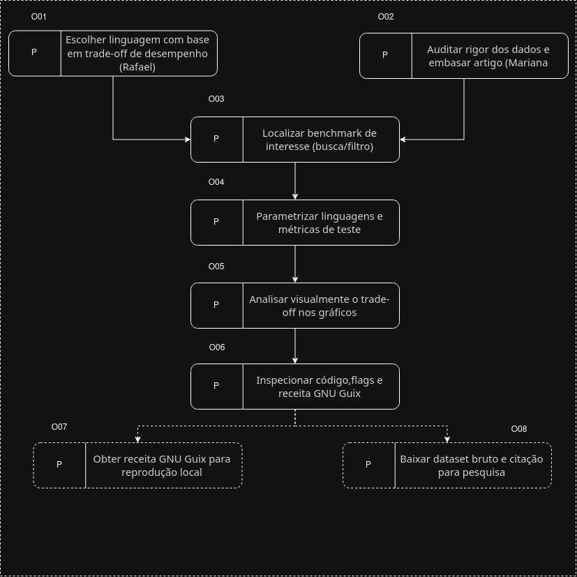

### Entrega 9 — Modelo conceitual e design centrado na comunicação

**Data:** 15/11/2026

**Status:** 🟩 concluída

**Responsabilidade:** João Pedro Bazoli Palma e Augusto Pereira Teixeira

#### Objetivo da atividade

Passar dos cenários de problema da Entrega 4 para a concepção da interação, definindo objetivos, tópicos de conversa e o esquema de signos da interface da plataforma BMML (*Benchmarking Multi-Linguagem*).

#### Transformando resultados técnicos em conceitos compreensíveis

A interface traduz os dados brutos de benchmarking e as receitas Linux/Guix em conceitos familiares e operacionais para os perfis de usuário:

* **Para o Gestor Técnico (P01 - Rafael):** *Trade-off* de desempenho (tempo de execução vs. consumo de memória RAM), dispersão gráfica (Scatter X vs Y), métricas médias por linguagem e filtros por perfil de algoritmo.
* **Para a Pesquisadora Acadêmica (P02 - Mariana):** Reprodutibilidade com GNU Guix (`time-machine`, `manifest.scm`), código-fonte com flags de build (`build.zig`, `-O3`), especificações do hardware de teste (CPU, RAM, Kernel) e exportação direta de dataset (`.csv`) e citação (`BibTeX`).

---

#### 1. Cenários de interação

##### CI01 — Comparação de desempenho para decisão técnica de arquitetura

**Autor(a):** João Pedro Bazoli Palma — 24.123.041-6

**Origem:** Cenário de problema C01 (Rafael Mendes — Gestor Técnico)

Rafael precisa definir a linguagem para um microsserviço de pagamentos sem depender de discussões subjetivas ou tabelas estáticas confusas.

**[SOLUÇÃO: Rafael acessa a plataforma BMML e utiliza o catálogo de algoritmos para localizar o teste "MergeSort". Ao abrir o visualizador interativo (Viewer), o sistema plota a dispersão correlacionando tempo e memória RAM. Na tabela de médias por linguagem, Rafael desmarca as opções que não interessam à infraestrutura da empresa, mantendo visíveis apenas Go, Rust e Java. Avaliando visualmente o trade-off de desempenho e o agrupamento de dispersão, Rafael confirma a melhor relação custo-benefício para a empresa e clica no link do dataset no cabeçalho para anexar os dados à ata técnica de arquitetura.]**

###### Diferenças relevantes

| Alteração | Por que foi necessária | Evidência/artefato que justifica |
|---|---|---|
| Catálogo categorizado com busca textual | Reduz o tempo de localização do benchmark representativo. | C01 (Entrega 4) e Meta MU02 (Entrega 8). |
| Gráfico interativo com tabela de visibilidade de séries | Permite confrontar tempo vs. memória e isolar linguagens em um clique. | Necessidade de P01 (Entrega 3) e Meta MU01 (Entrega 8). |
| Acesso imediato ao dataset tabular (.csv) no cabeçalho | Elimina transcrição manual de medições para relatórios gerenciais. | Consequência em C01 (Entrega 4). |

---

##### CI02 — Auditoria metodológica e exportação de dados para pesquisa

**Autor(a):** Augusto Pereira Teixeira — 24.123.008-5

**Origem:** Cenário de problema C02 (Mariana Costa — Pesquisadora Acadêmica)

Mariana precisa de dados rigorosos sobre o algoritmo MergeSort para fundamentar um artigo científico, mas não confia em medições da internet que omitem compiladores, hardware e sementes.

**[SOLUÇÃO: Mariana acessa a plataforma e digita "MergeSort" no campo de busca do catálogo, abrindo o benchmark desejado. No visualizador, ela acessa a visualização do código-fonte e das instruções de build para verificar as flags de otimização utilizadas. Em seguida, ela acessa a seção de reprodutibilidade para inspecionar o script com GNU Guix (`manifest.scm` e `channels.scm`), garantindo que o experimento é auditável e determinístico. Segura do rigor metodológico, ela clica no link do dataset bruto (`MergeSort.csv`) para importar os dados no R/Python e copia a referência formatada em BibTeX para seu artigo no Overleaf.]**

###### Diferenças relevantes

| Alteração | Por que foi necessária | Evidência/artefato que justifica |
|---|---|---|
| Exposição transparente de código, flags e receita Guix | Garante a reprodutibilidade científica e transparência metodológica. | C02 (Entrega 4) e Meta MU03 (Entrega 8). |
| Página dedicada de especificações da máquina física (About) | Fornece dados exatos de CPU, memória e kernel exigidos em artigos. | Princípios de Projeto (Entrega 8). |
| Download direto de CSV e cópia assistida de BibTeX | Elimina digitação manual de números e formatação manual de citações. | Tarefa T02 (Entrega 5) e Meta MU04 (Entrega 8). |

---

#### 2. Design centrado na comunicação

##### CI01 — Conversa de Rafael (Comparação no Dashboard)

| Tópico > subtópico | Falas e signos envolvidos | Intenção/efeito esperado |
|---|---|---|
| **Localizar benchmark** | **D:** "Aqui está o catálogo de benchmarks com 13 testes disponíveis."  **Signos:** `campo_busca`, `filtro_linguagem`, `card_algoritmo`. | Encontrar o benchmark representativo rapidamente. |
| **Comparar métricas** | **U:** "Quero confrontar as linguagens selecionadas em tempo e memória."  **D:** "Aqui está a dispersão X vs Y e as médias calculadas."  **Signos:** `seletor_metricas`, `tabela_medias_linguagens`, `grafico_dispersao`. | Avaliar visualmente o trade-off de desempenho. |

##### CI02 — Conversa de Mariana (Auditoria e Coleta)

| Tópico > subtópico | Falas e signos envolvidos | Intenção/efeito esperado |
|---|---|---|
| **Auditar reprodutibilidade** | **U:** "Quero conferir como o código foi compilado e o ambiente Guix."  **D:** "Aqui estão o código, as flags de build e o comando guix time-machine."  **Signos:** `bloco_codigo`, `bloco_build_flags`, `comando_guix_copia`. | Verificar o rigor científico e a reprodutibilidade do teste. |
| **Extrair dados científicos** | **U:** "Baixar dataset bruto e copiar referência para o artigo."  **D:** "Download do arquivo CSV iniciado e citação copiada."  **Signos:** `link_download_csv`, `botao_copiar_bibtex`, `toast_feedback`. | Coletar os artefatos de pesquisa para inclusão no artigo. |

---

#### 3. Mapa de objetivos

##### Dicionário de objetivos

| ID | Objetivo | Persona | Cenário | Prioridade |
|---|---|---|---|---|
| **O01** | Escolher linguagem com base em trade-off de desempenho | P01 (Rafael) | CI01 | Alta |
| **O02** | Auditar rigor dos dados e embasar artigo acadêmico | P02 (Mariana) | CI02 | Alta |
| **O03** | Localizar benchmark de interesse no catálogo (busca/filtro) | P01 e P02 | CI01 e CI02 | Alta |
| **O04** | Parametrizar métricas e visibilidade de linguagens | P01 | CI01 | Alta |
| **O05** | Analisar visualmente trade-off na dispersão gráfica | P01 | CI01 | Alta |
| **O06** | Inspecionar código-fonte, flags de build e receita GNU Guix | P02 | CI02 | Alta |
| **O07** | Obter receita GNU Guix para reprodução em ambiente próprio (opcional) | P02 | CI02 | Média |
| **O08** | Baixar dataset bruto tabular em CSV e citação BibTeX (opcional) | P02 | CI02 | Média |

---

#### 4. Esquema conceitual de signos

| Grupo | Signo | Origem | Observações/semântica | Tipo | Restrição | Padrão | Prevenção | Recuperação |
|---|---|---|---|---|---|---|---|---|
| **Catálogo** | `campo_busca` | Usuário | Campo para filtro dinâmico por nome de benchmark. | Texto | Máx. 50 caracteres | Vazio | **PP:** Placeholder indicativo ("benchmark name..."). | Limpar texto via teclado ou botão "X". |
| **Catálogo** | `card_algoritmo` | Sistema | Cartão do teste com métricas resumidas e link "Open in viewer →". | Elemento interativo | Clicável | — | **PP:** Destaque visual ao passar o cursor (hover). | Retornar via navegação do navegador ou breadcrumb. |
| **Viewer** | `seletor_metricas` | Usuário | Dropdowns para atribuir métricas aos eixos X e Y (tempo, memória). | Seleção única | Métricas válidas da base | X: Memória, Y: Tempo | **PP:** Rótulos padronizados (`X METRIC`, `Y METRIC`). | Alternância direta entre métricas nos seletores. |
| **Viewer** | `tabela_medias` | Usuário / Sistema | Tabela com médias por linguagem e checkboxes para ocultar/exibir séries. | Tabela interativa | Ao menos 1 série visível | Todas marcadas | **PP:** Instrução textual explicativa sobre desmarcar linhas. | Remarcar as caixas de seleção na tabela. |
| **Viewer** | `grafico_dispersao` | Sistema | Gráfico Scatter (X vs Y) correlacionando as métricas com cores por linguagem. | Gráfico interativo | Coordenadas positivas | — | **PP:** Legenda com cores vinculadas à tabela. | Atualização instantânea ao filtrar séries. |
| **Auditoria** | `bloco_guix` | Sistema | Bloco com o script reproduzível `guix time-machine` e botão Copy. | Código formatado | Somente leitura | — | **PP:** Realce de sintaxe e quebra de linha. | — |
| **Exportação** | `link_csv` | Usuário | Link no cabeçalho do viewer para download do arquivo bruto (`.csv`). | Link de ação | Clique único | — | **PP:** Identificação explícita do arquivo e volume de linhas. | Clicar novamente caso o download falhe. |
| **Exportação** | `botao_bibtex` | Usuário | Botão para copiar a citação formatada para a área de transferência. | Botão de ação | Clique único | — | **PP:** Notificação toast temporária ("Copiado!"). | Clicar novamente para recopiar. |

> **Prevenção:** **PP** = Prevenção Passiva (orientações visuais e instruções textuais); **PA** = Prevenção Ativa (travas da interface).

---

#### Síntese

Para a Entrega 10, a interação será modelada em **dois diagramas MoLIC** focados (um por integrante):

1. **MoLIC 01 — Rafael (João Pedro):** Cobre a localização do benchmark no catálogo e a análise interativa de *trade-off* no visualizador (`O01`, `O03`, `O04`, `O05`), manipulando os signos `campo_busca`, `seletor_metricas`, `tabela_medias` e `grafico_dispersao`.
2. **MoLIC 02 — Mariana (Augusto):** Cobre a auditoria de código, compilação e receita GNU Guix, finalizando com a exportação de CSV e citação BibTeX (`O02`, `O03`, `O06`, `O07`, `O08`), manipulando os signos `campo_busca`, `bloco_guix`, `link_csv` e `botao_bibtex`.

---

#### Checklist

* [x] Cenários mostram alterações em relação aos cenários de problema.
* [x] Cada solução identifica autor e cenário de origem.
* [x] Tópicos/falas/signos são coerentes com os objetivos do usuário.
* [x] Mapa consolidado unificado e aderente ao padrão aceito na disciplina.
* [x] Esquema de signos em tabela única, sem duplicações conceituais.
* [x] Nomes de objetivos e signos refletem a interface real do BMML e serão reaproveitados na Entrega 10.
