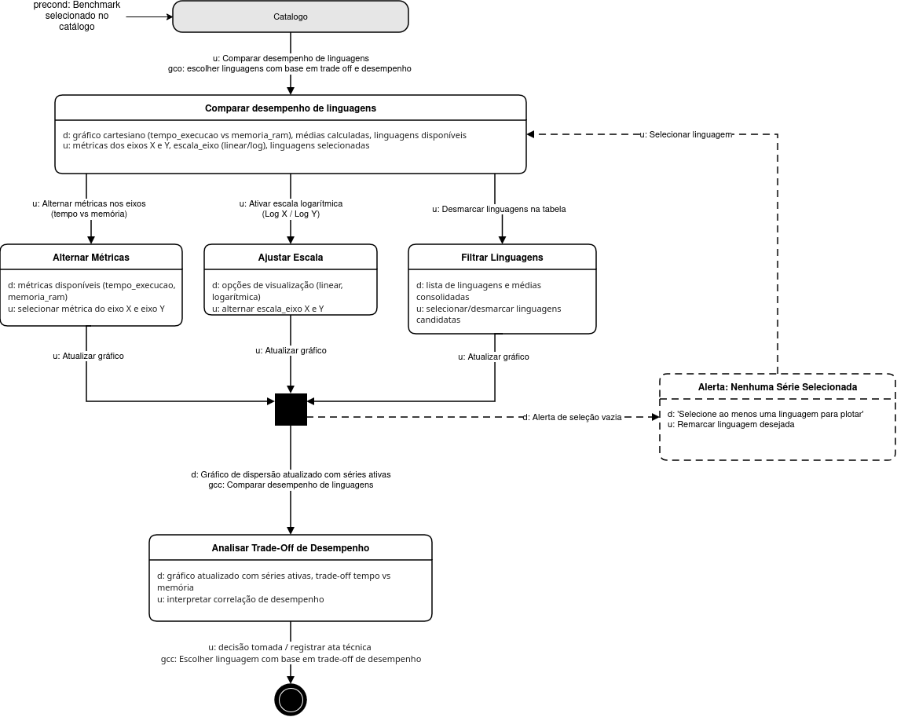
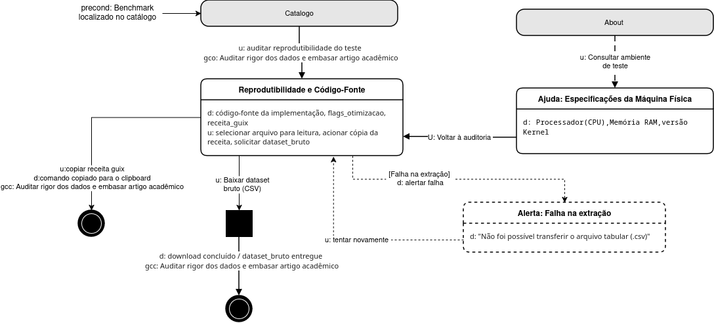

##### Entrega 10 — MoLIC

**Data:** 16/11/2026 (Revisado em 24/11/2026)

**Status:** 🟩 concluída

**Responsabilidade:** 1 solução completa por integrante

###### Objetivo da atividade

Modelar a interação como uma **conversa entre usuário e preposto do designer**, oferecendo visão global dos caminhos que permitem ao usuário atingir seus objetivos — incluindo alternativas e rupturas relevantes. MoLIC não deve ser reduzida a um fluxograma de telas. Use a **notação MoLIC ensinada na disciplina**. Este template foca critérios de qualidade e não substitui a legenda/notação apresentada em aula.

###### Atenção a TCCs sem interface original

O MoLIC não modela o algoritmo por dentro. Ele modela a **conversa de interação necessária para que uma pessoa use a contribuição**. Exemplos de conversas:

* usuário escolhe dados/parâmetros → sistema valida → usuário inicia análise → sistema comunica processamento → usuário interpreta resultado;
* usuário consulta histórico → refina filtros → abre execução → compara com outra;
* administrador seleciona perfil → altera permissão → sistema comunica consequências → administrador confirma/cancela;
* analista recebe alerta → examina evidências → classifica ocorrência → registra decisão.

Modele também rupturas plausíveis: entrada inválida, falha de processamento, ausência de resultado, permissão insuficiente, filtro sem resultados, conflito de alteração, cancelamento ou necessidade de recuperação.

--------------------------------------------------------------------------------

###### M01 — Comparação de Desempenho e Trade-Off entre Linguagens

**Autor(a):** João Pedro Bazoli Palma — 24.123.041-6

**Cenário de interação de origem:** CI01 (Rafael Mendes — Escolha de arquitetura)

**Objetivo(s):** O01 — Escolher linguagem com base em trade-off de desempenho

**Tarefa(s) relacionada(s):** T01 — Comparar métricas de desempenho entre linguagens

**Signos relevantes:** benchmark, tempo_execucao, memoria_ram, escala_eixo (linear/log), linguagem, selecao_candidatas e media_consolidada.

###### Diagrama

###### Leitura do diagrama

###### Caminho principal

1. **Abertura:** Com o benchmark selecionado no catálogo (precond:), o usuário dispara a transição de abertura com a meta formal: u: abrir comparativo do benchmark | gco: Escolher linguagem com base em trade-off de desempenho.
2. **Cena Central (Comparar Desempenho de Linguagens):** O preposto exibe a dispersão cartesiana correlacionando tempo e memória, a tabela com médias aritméticas consolidadas e as séries ativas (d:). O usuário define métricas nos eixos X e Y, alterna escala logarítmica (Log Y) e isola linguagens candidatas (u:).
3. **Parametrização e Atualização:** O usuário clica em u: atualizar parâmetros de visualização. O processamento interno do sistema é executado na caixa-preta ([■]), recalculando eixos e visibilidade de séries.
4. **Análise do Trade-Off:** O sistema devolve d: gráfico e médias atualizados com séries isoladas.
5. **Conclusão:** O usuário encerra o objetivo na cena Análise do Trade-Off com gcc: Escolher linguagem com base em trade-off de desempenho e finaliza a decisão em u: definir tecnologia e registrar ata técnica (◎).

###### Alternativas e rupturas

| Situação | Onde ocorre | Como o usuário percebe | Caminho de recuperação/saída |
| :--- | :--- | :--- | :--- |
| **Ruptura: Nenhuma série selecionada** | Caixa-preta após filtro de linguagens | O sistema barra a atualização e abre a cena tracejada Alerta: Seleção Vazia (d: "Selecione ao menos uma linguagem para visualizar a comparação"). | Seta tracejada u: restaurar seleção padrão retorna à tela com as séries reativadas. |
| **Alternativa: Ajuste de escala direto** | Cena central | O usuário altera apenas Log X ou Log Y sem mexer nos filtros de séries. | Segue diretamente para o processamento ([■]) e recalcula os eixos de imediato. |

###### Checklist específico de modelagem

* [x] Existe ponto de abertura coerente com o início do objetivo (gco: explícito).
* [x] As cenas de conversa representam tópicos/assuntos, não nomes de páginas apenas.
* [x] As transições/falas deixam claro o que o usuário (u:) ou o sistema (d:) comunica, sem uso indevido de d+u:.
* [x] Há ponto(s) de encerramento para objetivos concluídos com gcc: conectado ao ponto final (◎).
* [x] Processamentos do sistema estão representados conforme a notação adotada em aula ([■]), sem inventar fala do usuário.
* [x] Rupturas relevantes têm feedback e caminho de recuperação com linhas tracejadas, não becos sem saída.
* [x] Acessos ubíquos só aparecem quando semanticamente justificáveis.
* [x] O diagrama cobre caminhos alternativos importantes, e não apenas o happy path.
* [x] Nomes de objetivos, tópicos e signos são coerentes com a Entrega 9 e a Rastreabilidade.
* [x] O diagrama é legível em tamanho normal no GitHub.
* [x] O MoLIC representa a conversa usuário–sistema, não o fluxo interno do algoritmo.
* [x] Processamento, filtros, administração, relatórios e históricos incluem retornos/rupturas quando relevantes.

--------------------------------------------------------------------------------

###### M02 — Auditoria Metodológica e Reprodutibilidade Experimental

**Autor(a):** Augusto Pereira Teixeira — 24.123.008-5

**Cenário de interação de origem:** CI02 (Mariana Costa — Pesquisa acadêmica)

**Objetivo(s):** O02 — Auditar rigor dos dados e embasar artigo acadêmico

**Tarefa(s) relacionada(s):** T02 — Inspecionar reprodutibilidade do benchmark e exportar dataset

**Signos relevantes:** ambiente_execucao, flags_otimizacao (-O3), receita_guix, codigo_fonte, dataset_bruto (.csv) e referencia_bibtex.

###### Diagrama

###### Leitura do diagrama

###### Caminho principal (Auditoria do Guix e Extração)

1. **Abertura:** Com o teste localizado no catálogo (precond:), a pesquisadora abre a conversa formal de auditoria: u: inspecionar reprodutibilidade | gco: Auditar rigor dos dados e embasar artigo acadêmico.
2. **Cena Central (Inspecionar Reprodutibilidade e Código-Fonte):** Cena com borda sólida contínua onde o preposto apresenta código-fonte, flags de compilação (-O3) e receita declarativa GNU Guix (d:), e a usuária inspeciona parâmetros, copia comandos e solicita artefatos (u:).
3. **Cópia da Receita de Reprodução:** Loop reflexivo que sai da cena central e retorna para ela mesma: a usuária aciona u: copiar receita GNU Guix e o preposto responde d: comando copiado para o clipboard.
4. **Extração do Dataset Bruto Tabular:** A usuária solicita u: baixar dataset bruto (.csv). O sistema processa o arquivo na caixa-preta ([■]).
5. **Conclusão e Fechamento:** O sistema entrega o arquivo (d: download do arquivo CSV concluído), a usuária copia a citação (u: copiar referência BibTeX) e encerra a meta com gcc: Auditar rigor dos dados e embasar artigo acadêmico até o ponto final (◎).

###### Alternativas e rupturas

| Situação | Onde ocorre | Como o usuário percebe | Caminho de recuperação/saída |
| :--- | :--- | :--- | :--- |
| **Alternativa: Consulta ao ambiente de teste** | Acesso ubíquo About no cabeçalho | O usuário clica na pílula permanente u: About BMML e acessa a cena normal Consultar Ambiente de Execução (com borda sólida contínua, pois é consulta informativa). | O preposto informa CPU Ryzen 5, 32GB RAM e Kernel Linux (d:). O usuário clica em u: voltar ao benchmark e retorna à cena central sem perder nada. |
| **Ruptura: Falha na extração do arquivo tabular** | Caixa-preta de download do dataset | Ocorre interrupção ou erro de leitura ([falha na extração]). A transição tracejada conduz à cena tracejada Alerta: Falha na Extração (d: "Não foi possível transferir o arquivo tabular"). | Seta tracejada de recuperação u: tentar novamente retorna à cena central para nova tentativa de download. |

###### Checklist específico de modelagem

* [x] Existe ponto de abertura coerente com o início do objetivo (gco: explícito).
* [x] As cenas de conversa representam tópicos/assuntos, não nomes de páginas apenas.
* [x] As transições/falas deixam claro o que o usuário (u:) ou o sistema (d:) comunica, sem uso indevido de d+u:.
* [x] Há ponto(s) de encerramento para objetivos concluídos com gcc: conectado ao ponto final (◎).
* [x] Processamentos do sistema estão representados conforme a notação adotada em aula ([■]), sem inventar fala do usuário.
* [x] Rupturas relevantes têm feedback e caminho de recuperação com linhas tracejadas, não becos sem saída.
* [x] Acessos ubíquos/atalhos só aparecem quando semanticamente justificáveis e em linha contínua para consultas normais.
* [x] O diagrama cobre caminhos alternativos importantes, e não apenas o happy path.
* [x] Nomes de objetivos, tópicos e signos são coerentes com a Entrega 9 e a Rastreabilidade.
* [x] O diagrama é legível em tamanho normal no GitHub.
* [x] O MoLIC representa a conversa usuário–sistema, não o fluxo interno do algoritmo.
* [x] Processamento, filtros, administração, relatórios e históricos incluem retornos/rupturas quando relevantes.

--------------------------------------------------------------------------------

###### Consolidação da equipe

###### Cobertura dos objetivos

| Objetivo | MoLIC que cobre | Lacunas/duplicidades | Decisão |
| :--- | :--- | :--- | :--- |
| **O01** — Escolher linguagem com base em trade-off de desempenho | **M01** (Rafael Mendes) | Nenhuma. Foco total no gráfico interativo e filtros. | Modelar parametrização dinâmica e recuperação de seleção vazia. |
| **O02** — Auditar reprodutibilidade e exportar dados | **M02** (Mariana Costa) | Duplicidade evitada. O download de CSV fica restrito ao M02. | Separar cópia rápida de receita (clipboard via loop), download de CSV com processamento e consulta de hardware via acesso ubíquo. |

###### Preparação para o Figma

Componentes e telas derivados das conversas do MoLIC:

1. **Visualizador de Benchmark (M01 / F02 e F03):** Gráfico de dispersão cartesiano com eixos dinâmicos, botões de escala logarítmica e tabela com checkboxes.
2. **Feedback de Ruptura (M01 / F03-Alerta):** Alerta visual inline quando nenhuma série estiver selecionada com botão de restauração.
3. **Reprodutibilidade e Código (M02 / F04, F05 e F07):** Bloco de código com flags -O3, comando Guix com botão de copiar, toast de confirmação e link de download do CSV.
4. **Página Informativa de Ambiente (M02 / F06):** Tela About acessível pelo cabeçalho superior documentando a CPU, RAM física e Kernel determinístico.
