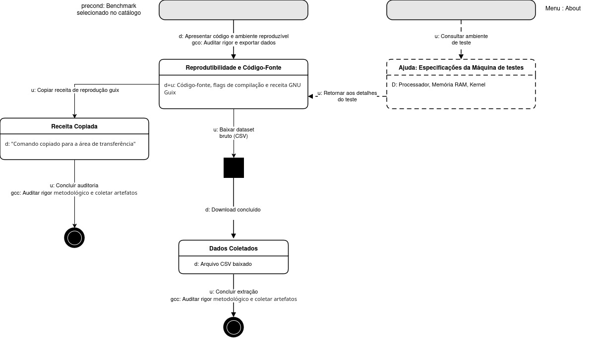

### Entrega 10 — MoLIC

**Data:** 16/11/2026

**Status:** 🟩 concluída

**Responsabilidade:** 1 solução completa por integrante

#### Objetivo da atividade

Modelar a interação como uma **conversa entre usuário e preposto do designer**, oferecendo visão global dos caminhos que permitem ao usuário atingir seus objetivos — incluindo alternativas e rupturas relevantes. MoLIC não deve ser reduzida a um fluxograma de telas. Use a **notação MoLIC ensinada na disciplina**. Este template foca critérios de qualidade e não substitui a legenda/notação apresentada em aula.

#### Atenção a TCCs sem interface original

O MoLIC não modela o algoritmo por dentro. Ele modela a **conversa de interação necessária para que uma pessoa use a contribuição**. Exemplos de conversas:

* usuário escolhe dados/parâmetros → sistema valida → usuário inicia análise → sistema comunica processamento → usuário interpreta resultado;
* usuário consulta histórico → refina filtros → abre execução → compara com outra;
* administrador seleciona perfil → altera permissão → sistema comunica consequências → administrador confirma/cancela;
* analista recebe alerta → examina evidências → classifica ocorrência → registra decisão.

Modele também rupturas plausíveis: entrada inválida, falha de processamento, ausência de resultado, permissão insuficiente, filtro sem resultados, conflito de alteração, cancelamento ou necessidade de recuperação.

---

#### M01 — Comparação de Desempenho e Trade-Off entre Linguagens

**Autor(a):** João Pedro Bazoli Palma — 24.123.041-6

**Cenário de interação de origem:** CI01 (Rafael Mendes — Escolha de arquitetura)

**Objetivo(s):** O01 — Comparar tempo de execução versus memória

**Tarefa(s) relacionada(s):** T01 — Comparar métricas de desempenho entre linguagens

**Signos relevantes:** Gráfico de dispersão, seletores de eixos (tempo/memória), opções logarítmicas (Log X/Y) e checkboxes da tabela de linguagens.

##### Diagrama

##### Leitura do diagrama

###### Caminho principal

1. **Abertura:** Com o benchmark selecionado no catálogo (`precond:`), o sistema disponibiliza a tela e abre a conversa (`gco: Comparar desempenho de linguagens`).
2. **Visualizador de Benchmark:** O preposto exibe o gráfico e a tabela (`d+u:`).
3. **Parametrização:** O usuário ajusta métricas, escala ou desmarca linguagens em três caixas paralelas (`d+u:`).
4. **Atualização:** O usuário clica em `u: Atualizar gráfico`. O sistema recalcula os dados no quadrado preto (`[■]`).
5. **Conclusão:** O sistema devolve `d: Exibir gráfico atualizado`, encerra a meta (`gcc:`) na cena **Análise do Trade-Off** e o usuário finaliza em `u: Concluir decisão` (`◎`).

###### Alternativas e rupturas

| Situação | Onde ocorre | Como o usuário percebe | Caminho de recuperação/saída |
| :--- | :--- | :--- | :--- |
| **Ruptura: Nenhuma série selecionada** | Filtro de linguagens | O sistema barra a atualização e abre a cena tracejada `Alerta: Seleção Vazia` (`d: "Selecione ao menos uma linguagem..."`). | Seta tracejada `u: Restaurar seleção de linguagens` retorna à tela com as séries reativadas. |
| **Alternativa: Ajuste de escala direto** | Cena central | O usuário altera apenas Log X ou Log Y sem mexer nos filtros. | Segue para `u: Atualizar gráfico` e recalcula os eixos de imediato. |

##### Checklist específico de modelagem

* [x] Existe **ponto de abertura** coerente com o início do objetivo.
* [x] As **cenas de conversa** representam tópicos/assuntos, não nomes de páginas apenas.
* [x] As transições/falas deixam claro o que o usuário ou o sistema comunica.
* [x] Há **ponto(s) de encerramento** para objetivos concluídos/abandonados quando aplicável.
* [x] Processamentos do sistema estão representados conforme a notação adotada em aula, sem "inventar" fala do usuário.
* [x] Rupturas (breakdowns) relevantes têm feedback e caminho de recuperação, não becos sem saída.
* [x] Acessos ubíquos/atalhos só aparecem quando semanticamente justificáveis.
* [x] O diagrama cobre caminhos alternativos importantes, e não apenas o "happy path".
* [x] Nomes de objetivos, tópicos e signos são coerentes com a Entrega 9.
* [x] O diagrama é legível em tamanho normal no GitHub.
* [x] O MoLIC representa a conversa usuário–sistema, não o fluxo interno do algoritmo.
* [x] Processamento, filtros, administração, relatórios e históricos incluem retornos/rupturas quando relevantes.

---

#### M02 — Auditoria Metodológica e Reprodutibilidade Experimental

**Autor(a):** Augusto Pereira Teixeira — 24.123.008-5

**Cenário de interação de origem:** CI02 (Mariana Costa — Pesquisa acadêmica)

**Objetivo(s):** O02 — Auditar rigor metodológico e obter artefatos experimentais

**Tarefa(s) relacionada(s):** T02 — Buscar e comparar métricas para artigo acadêmico

**Signos relevantes:** Código-fonte, flags de compilação (`-O3`), receita declarativa GNU Guix, botão de cópia, menu ubíquo `About` e download do `.csv`.

##### Diagrama

##### Leitura do diagrama

###### Caminho principal (Auditoria do Guix)

1. **Abertura:** Com o teste localizado no catálogo (`precond:`), o preposto abre a cena com o código e a meta (`gco: Auditar rigor e coletar artefatos`).
2. **Reprodutibilidade e Código-Fonte:** A pesquisadora inspeciona código, flags e o script do Guix (`d+u:`).
3. **Cópia da Receita:** A usuária aciona `u: Copiar receita de reprodução (Guix)`.
4. **Confirmação Imediata:** Por ser cópia para o clipboard, o sistema apenas avisa na cena **Receita Copiada** (`d: "Comando no clipboard"`).
5. **Fechamento:** A usuária clica em `u: Concluir auditoria`, ocorrendo o fechamento de sucesso (`gcc:`) até o ponto final (`◎`).

###### Alternativas e rupturas

| Situação | Onde ocorre | Como o usuário percebe | Caminho de recuperação/saída |
| :--- | :--- | :--- | :--- |
| **Alternativa: Consulta ao ambiente de teste** | Menu ubíquo `About` | O usuário clica na pílula permanente `About` e acessa a cena de ajuda tracejada (`Ajuda: Máquina de Teste`). | O preposto informa CPU e RAM (`d:`). O usuário clica em `u: Voltar ao teste` e retorna à cena central sem perder nada. |
| **Alternativa: Download do CSV bruto** | Cena central | O usuário aciona `u: Baixar medições brutas (CSV)`. | O sistema processa o envio no quadrado preto (`[■]`), entrega o arquivo na cena `Dados Obtidos` e encerra com `gcc:`. |

##### Checklist específico de modelagem

* [x] Existe **ponto de abertura** coerente com o início do objetivo.
* [x] As **cenas de conversa** representam tópicos/assuntos, não nomes de páginas apenas.
* [x] As transições/falas deixam claro o que o usuário ou o sistema comunica.
* [x] Há **ponto(s) de encerramento** para objetivos concluídos/abandonados quando aplicável.
* [x] Processamentos do sistema estão representados conforme a notação adotada em aula, sem "inventar" fala do usuário.
* [x] Rupturas (breakdowns) relevantes têm feedback e caminho de recuperação, não becos sem saída.
* [x] Acessos ubíquos/atalhos só aparecem quando semanticamente justificáveis.
* [x] O diagrama cobre caminhos alternativos importantes, e não apenas o "happy path".
* [x] Nomes de objetivos, tópicos e signos são coerentes com a Entrega 9.
* [x] O diagrama é legível em tamanho normal no GitHub.
* [x] O MoLIC representa a conversa usuário–sistema, não o fluxo interno do algoritmo.
* [x] Processamento, filtros, administração, relatórios e históricos incluem retornos/rupturas quando relevantes.

---

#### Consolidação da equipe

##### Cobertura dos objetivos

| Objetivo | MoLIC que cobre | Lacunas/duplicidades | Decisão |
| :--- | :--- | :--- | :--- |
| **O01** — Comparar tempo e memória para decisão técnica | **M01** (Rafael Mendes) | Nenhuma. Foco total no gráfico interativo e filtros. | Modelar parametrização e recuperação de seleção vazia. |
| **O02** — Auditar reprodutibilidade e exportar dados | **M02** (Mariana Costa) | Duplicidade evitada. O download de CSV fica restrito ao M02. | Separar cópia rápida de receita (clipboard) de download com processamento (`.csv`). |

##### Preparação para o Figma

Componentes e telas derivados das conversas do MoLIC:

1. **Visualizador de Benchmark (M01):** Gráfico de dispersão com eixos dinâmicos, botões de escala logarítmica e tabela com checkboxes.
2. **Feedback de Ruptura (M01):** Alerta visual quando nenhuma série estiver selecionada com botão de restauração.
3. **Reprodutibilidade e Código (M02):** Bloco de código com flags `-O3`, comando Guix com botão de copiar, toast de confirmação e link de download do CSV.
4. **Modal de Hardware (`About` - M02):** Painel acessível pelo topo informando Ryzen 5 3600, 32GB RAM e Kernel Guix, com botão de fechar.

---

#### Erros frequentes a evitar

* desenhar apenas caixas com nomes de telas e setas de navegação;
* não modelar falhas, cancelamento, volta ou recuperação;
* usar rótulos genéricos ("Tela 1", "Processo 2") sem tópico de conversa;
* criar no Figma fluxos que não existem no MoLIC;
* diagrama sem legenda/fonte editável e com texto ilegível.
