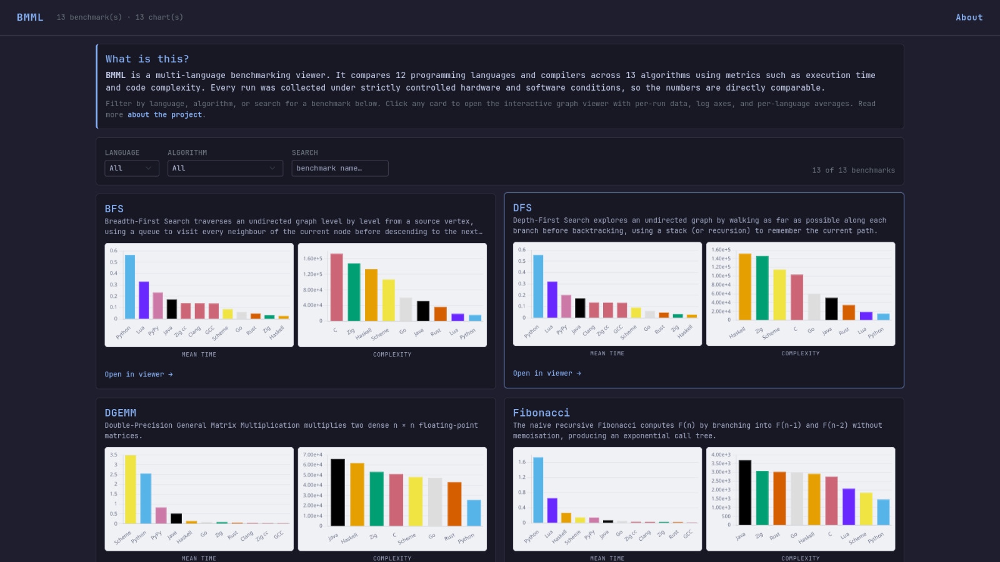
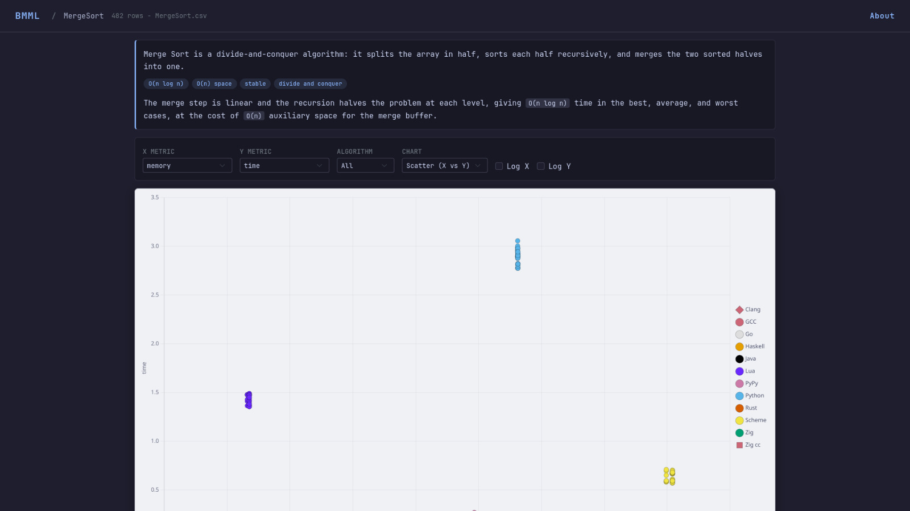
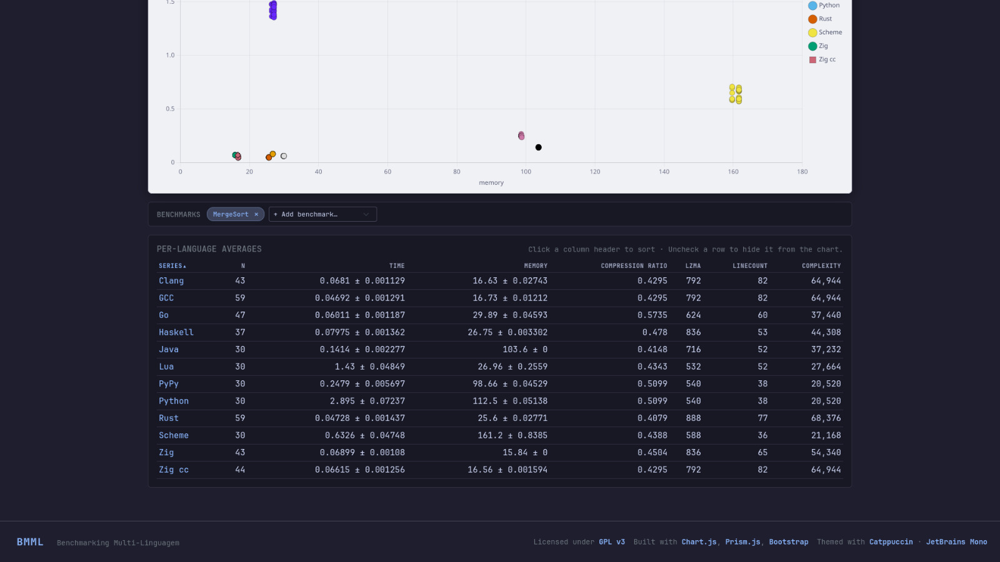
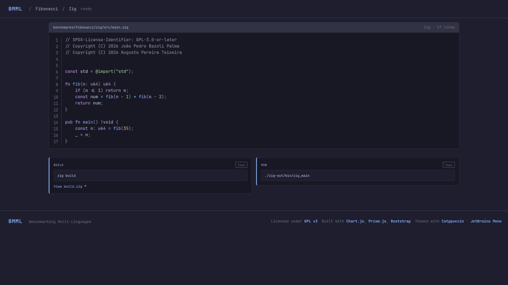
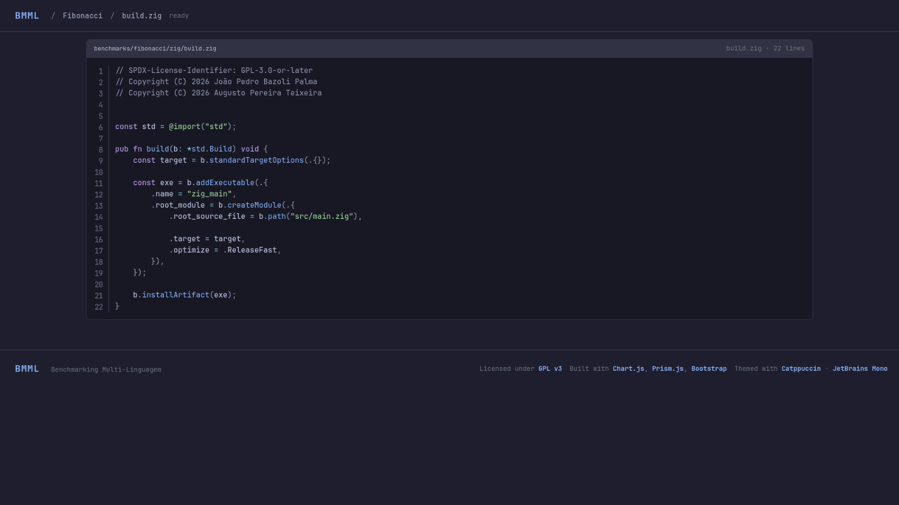
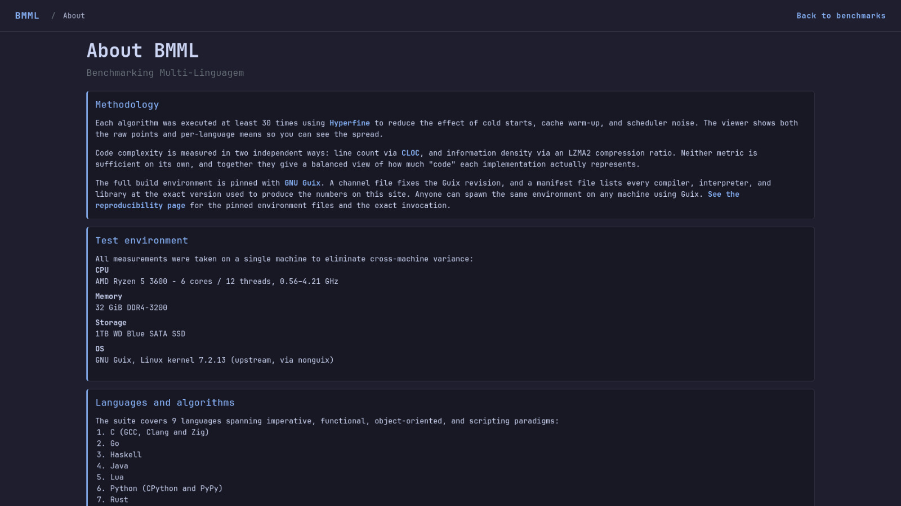
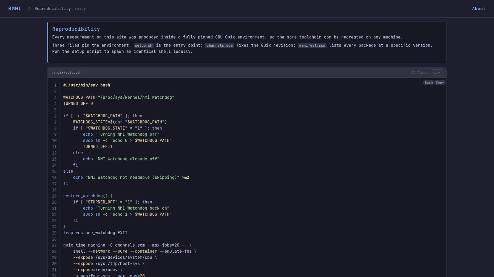

##### Entrega 11 — Protótipo de Interface

**Data:** 16/11/2026

**Status:** 🟩 concluída

**Responsabilidade:** 1 especificação integrada de telas cobrindo os fluxos MoLIC.

###### Objetivo da atividade

Materializar o modelo de interação em um protótipo de telas, preservando a lógica dos objetivos, tópicos, signos, feedbacks, alternativas e recuperações definidos anteriormente.

###### Biblioteca de possibilidades para projetos técnicos

O protótipo deve materializar os fluxos definidos nas entregas anteriores. Dependendo do escopo, podem fazer sentido:

1. **Dashboard:** indicadores, alertas, estado, tendências e atalhos para tarefas frequentes.
2. **Configuração/parametrização:** escolhas, presets, validação e explicação de opções técnicas.
3. **Entrada de dados:** upload, conexão, seleção, pré-visualização e validação.
4. **Processamento:** fila, status, progresso, cancelamento, falha e reexecução.
5. **Relatório/resultados:** síntese, métricas, gráficos, explicação, exportação e compartilhamento.
6. **Histórico:** busca, filtros, ordenação, paginação, detalhes e repetição de execução.
7. **Comparação:** antes/depois, modelo A/B, execução A/B, baseline ou períodos.
8. **Explicabilidade:** confiança, fatores, evidências, limitações e correção/contestação.
9. **Administração:** usuários, grupos, perfis, permissões, integrações e políticas.
10. **CRUDs de domínio:** somente quando criar/consultar/editar/excluir representa tarefa real.
11. **Auditoria/logs:** histórico de alterações e eventos em linguagem adequada.
12. **Alertas/ocorrências:** severidade, impacto, ação, responsável e resolução.
13. **Ajuda/documentação:** apoio contextual a tarefas complexas.

###### Estados que não podem ser esquecidos

Quando aplicável, considere: vazio/sem dados; carregamento/processamento; sucesso; erro de entrada; erro de processamento; filtro sem resultados; permissão insuficiente; confirmação de ação destrutiva; cancelamento/desfazer/recuperação; dados desatualizados/conflito. Esta lista é repertório de design, **não uma exigência de quantidade de telas**. A rastreabilidade deve explicar por que cada tela existe.

--------------------------------------------------------------------------------

###### Cobertura MoLIC → Telas da Interface

| MoLIC | Objetivo | Fluxo de telas | Estados de erro/recuperação | Responsável |
| ------ | ------ | ------ | ------ | ------ |
| **M01** | **O01** — Comparar desempenho (tempo vs. memória) entre linguagens | F01 (Catálogo) → F02 (Dispersão/Eixos) → F03 (Tabela de Médias e Filtros) | F03-ERRO (Alerta inline de seleção vazia ao desmarcar todas as séries) → Restauração de seleção padrão | João Pedro Bazoli Palma |
| **M02** | **O02** — Auditar reprodutibilidade, flags e extrair artefatos | F01 (Catálogo) → F04 (Código) → F05 (Flags) → F07 (Guix) e F02 (Link CSV) | F06 (Página de especificações About acessível pelo menu superior) | Augusto Pereira Teixeira |

--------------------------------------------------------------------------------

###### Catálogo de telas/estados

##### F01 — Home e Catálogo de Benchmarks

* **Objetivo do usuário:** Navegar pela biblioteca de 13 benchmarks disponíveis e selecionar o algoritmo para análise comparativa.
* **Signos principais:** Cards de algoritmos (BFS, DFS, Fibonacci, MergeSort), categorização de carga (CPU-bound / Memory-bound) e botão superior `About`.
* **Origem no MoLIC:** Pré-condição global de abertura de M01 e M02 (`precond: Benchmark selecionado no catálogo`).

---

##### F02 — Visualizador de Dispersão e Controles de Eixos (M01)

* **Objetivo do usuário:** Analisar a relação de trade-off entre tempo de execução e memória, ajustando métricas e aplicando escalas logarítmicas.
* **Signos principais:** Gráfico de dispersão cartesiano, seletores de eixos (`X METRIC`, `Y METRIC`), toggles `Log X` / `Log Y` e link de extração direta do dataset (`MergeSort.csv`).
* **Origem no MoLIC:** Região superior da página do algoritmo, correspondendo à cena principal `Visualizador de Benchmark (Viewer)` e caixas de parametrização `Alternar Métricas` e `Ajustar Escala` do M01.

---

##### F03 — Tabela de Médias e Filtragem de Séries (M01)

* **Objetivo do usuário:** Comparar médias sumarizadas por linguagem e desmarcar séries para filtrar os pontos exibidos no gráfico.
* **Signos principais:** Tabela de médias, ordenação por cabeçalho de coluna e checkboxes para exibir/ocultar cada linguagem.
* **Origem no MoLIC:** Região inferior da página do algoritmo (mesma unidade de apresentação de F02), correspondendo à caixa de controle `Filtrar Linguagens` e gatilho do estado de alerta `Alerta: Nenhuma Série Selecionada`.

---

##### F04 — Auditoria de Código-Fonte e Comandos (M02)

* **Objetivo do usuário:** Inspecionar o código-fonte de cada implementação para verificar paridade algorítmica e copiar comandos de execução local.
* **Signos principais:** Visualizador de sintaxe (`main.zig`), numeração de linhas e caixas de comando `BUILD` / `RUN` com botão interativo `Copy`.
* **Origem no MoLIC:** Cena `Reprodutibilidade e Código-Fonte` do M02.

---

##### F05 — Auditoria de Otimização e Flags de Compilação (M02)

* **Objetivo do usuário:** Conferir os parâmetros de otimização de máquina (`.ReleaseFast` / `-O3`) aplicados ao binário de teste.
* **Signos principais:** Arquivo de configuração de build (`build.zig`), diretivas de compilação e flags de otimização.
* **Origem no MoLIC:** Signo de rigor metodológico modelado na cena `Reprodutibilidade e Código-Fonte` do M02.

---

##### F06 — Página de Especificações e Ambiente de Teste (About BMML)

* **Objetivo do usuário:** Consultar a qualquer momento a máquina física e o kernel em que os testes foram executados, retornando à análise pelo link de navegação.
* **Signos principais:** Breadcrumb BMML / About, especificações de hardware (CPU AMD Ryzen 5 3600, 32GB RAM DDR4), Kernel Linux e link de retorno "Back to benchmarks".
* **Origem no MoLIC:** Acesso permanente no menu superior que conduz à página informativa de infraestrutura física e metodológica.

---

##### F07 — Receita de Reprodutibilidade GNU Guix (M02)

* **Objetivo do usuário:** Copiar o script declarativo do contêiner GNU Guix para reprodução exata dos benchmarks no terminal.
* **Signos principais:** Bloco de script (`setup.sh`), comando `guix time-machine`, botão interativo `Copy` e feedback de cópia no clipboard.
* **Origem no MoLIC:** Transição `u: copiar receita de reprodução guix` e cena de feedback imediato `Receita Copiada` do M02.

--------------------------------------------------------------------------------

###### Sistema visual e consistência

| Elemento | Regra adotada | Justificativa |
| ------ | ------ | ------ |
| **Tipografia** | Sans-serif (Inter) para interface e controles; Monospace (JetBrains Mono) para código e comandos de terminal. | Garante rápida leitura em painéis densos e preserva a clareza de caracteres técnicos (-O3, $, caminhos). |
| **Cores** | Dark mode estrito com fundo escuro (#121214), superfícies de dados em cinza (#202024) e texto em alto contraste (#E1E1E6). | Garante alto contraste visual, adequação à estética de ferramentas técnicas e suporte à diferenciação de pontos coloridos no gráfico sobre fundo escuro. |
| **Componentes** | Toggles de escala (switches), checkboxes de seleção rápida e blocos de código com botão Copy integrado. | Consistência operacional com convenções da web técnica, posicionando controles de ação próximos aos respectivos blocos de dados. |
| **Feedback** | Toasts temporários para cópias de texto e avisos inline para restrições de filtragem. | Mantém o usuário ciente das ações do sistema sem interromper o fluxo de análise com modais desnecessários. |

--------------------------------------------------------------------------------

###### Diretrizes de acessibilidade adotadas no design

1. **Contraste de Cores:** Relação texto/fundo superior a 4.5:1 (conforme WCAG 2.1 AA) em todos os textos críticos e rótulos de dados.
2. **Área de Clique:** Botões de ação (Copy, seletores de eixos e toggles) possuem área mínima de clique planejada de 40x40px para prevenção de erros motores.
3. **Cores Redundantes:** O gráfico de dispersão associa as cores dos pontos diretamente às legendas e nomes fixos da tabela de médias, auxiliando usuários daltônicos.
4. **Navegação Lógica:** Estrutura tabular e de cartões organizada em ordem lógica de navegação: Catálogo → Controles → Gráfico → Código.

--------------------------------------------------------------------------------

###### Checklist

* [x] Screenshots representativos e mapeados estão presentes no repositório.
* [x] Todos os MoLIC relevantes estão cobertos.
* [x] Estados operacionais principais foram contemplados e demonstrados.
* [x] Terminologia/signos são consistentes com Entrega 9.
* [x] Componentes equivalentes se comportam de forma consistente.
* [x] Fluxos críticos estão demonstrados do início ao fim.
* [x] As telas estão prontas para inspeção visual sem links quebrados.
* [x] Dashboards, relatórios, históricos, filtros, administração e CRUDs presentes possuem justificativa rastreável.
* [x] Estados de vazio, processamento, erro e recuperação foram considerados quando pertinentes.
* [x] Resultados técnicos são apresentados de forma interpretável para o perfil de usuário.
* [x] A equipe distingue na interface o que é interação simulada e o que é funcionalidade técnica realmente integrada.
