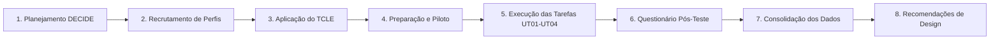

##### Entrega 14 — Avaliação de usabilidade por observação de usuários

**Data:** 16/11/2026 (Revisado em 23/11/2026)

**Status:** 🟩 concluída

**Responsabilidade:** Solução consolidada por equipe (2 participantes observados, sendo 1 por integrante).

###### Objetivo da atividade

Observar usuários representativos realizando tarefas reais ou realisticamente simuladas no protótipo BMML para identificar problemas de eficácia, eficiência, compreensão e satisfação que não puderam ser inferidos apenas por inspeção. A avaliação investiga estritamente a **qualidade da interação e da interface**, sem julgar o mérito técnico ou científico dos algoritmos e compiladores do TCC.

--------------------------------------------------------------------------------

###### A. Fluxograma do processo — equipe

--------------------------------------------------------------------------------

###### B. Procedimento de preparação e execução — equipe

###### Passo 1 — Objetivos e versão avaliada

* **Versão/Figma:** Protótipo de Telas BMML em Alta Fidelidade (Telas F01 a F07 catalogadas na Entrega 11).
* **Metas de usabilidade relacionadas:** Eficácia de leitura de dados de benchmark sem assistência (conclusão em < 60s), eficiência na filtragem paramétrica de séries (conclusão em < 90s) e transparência na identificação de hardware e comandos de reprodução (< 45s).

###### Passo 2 — Participantes

| ID | Perfil | Critérios que justificam participação (*Proxy*) | Integrante responsável |
| ------ | ------ | ------ | ------ |
| **U01** | Estudante de Ciência da Computação (8º ciclo) | Conhecimento prévio em linguagens compiladas (C, Rust), complexidade de algoritmos e familiaridade com gráficos de dispersão. Atua como participante *proxy* representando a persona Rafael Mendes (Desenvolvedor). | João Pedro Bazoli Palma |
| **U02** | Estudante de Ciência da Computação (8º ciclo) | Conhecimento prático de sistemas operacionais, ambiente Linux, uso de terminal e testes de software. Atua como participante *proxy* representando a persona Mariana Costa (Pesquisadora/Auditora). | Augusto Pereira Teixeira |

**Nota metodológica (Participantes Proxy):** Devido à proximidade com a conclusão do curso e ao domínio consolidado dos conceitos da área (compilação, consumo de memória, CPU e análise experimental), os participantes possuem repertório técnico suficiente para simular com realismo as tarefas do sistema. Contudo, por serem participantes acadêmicos (*proxy*) e não profissionais sêniores atuando no mercado corporativo ou pesquisadores de pós-graduação estrita, os resultados foram consolidados cientes dessa limitação amostral.

###### Passo 3 — Consentimento e privacidade

* **Termo de consentimento:** Termo formal aplicado e aceito antes do início da sessão com garantias de anonimato e voluntariedade ([termo_consentimento_modelo.md](../instrumentos/termo_consentimento_modelo.md)). Contatos institucionais fornecidos: jpbazolip@gmail.com e augusto.teixeira03@proton.me
* **Gravação audiovisual:** Conforme assegurado no TCLE (garantia de voluntariedade e recusa sem penalidades), os participantes manifestaram desconforto quanto à gravação de sua imagem e áudio em vídeo. Em respeito à autonomia dos voluntários, a coleta foi realizada presencialmente com registro estrito por anotações em tempo real em planilha estruturada, registrando-se a ausência de vídeo público como uma limitação de conformidade da coleta.
* **Anonimização:** Participantes identificados estritamente pelos códigos anônimos U01 e U02.
* **Armazenamento:** Planilhas e formulários brutos arquivados digitalmente no repositório restrito da equipe, com descarte previsto ao final do semestre letivo.

###### Passo 4 — Teste piloto

* **Data:** 16/11/2026.
* **Participante do piloto:** Aluno do curso independente da equipe de desenvolvimento.
* **O que foi validado:** Clareza do roteiro de tarefas neutras, calibração do cronômetro, tempo médio de realização e fluidez de navegação entre as telas do protótipo.
* **Mudança após piloto:** A instrução de UT02 foi refinada: a redação original *"filtre os dados do gráfico"* gerava hesitação sobre quais séries isolar; a versão revisada especificou formalmente o objetivo de manter apenas duas séries e utilizar escala logarítmica vertical.

###### Passo 5 — Tarefas

| ID | Cenário / Instrução apresentada | Critério de sucesso | Métricas | Ligação com modelo |
| ------ | ------ | ------ | ------ | ------ |
| **UT01** | *"Acesse o benchmark 'MergeSort' e descubra qual linguagem teve o menor tempo médio de execução."* | Identificar a linguagem mais rápida lendo o menor valor na tabela ordenada. | Sucesso, tempo (s), erros, ajudas, satisfação (1-5). | F01 → F02 (M01 / O01) |
| **UT02** | *"No gráfico do MergeSort, deixe visíveis apenas as linguagens C e Rust e ative a escala logarítmica no eixo vertical (Y)."* | Desmarcar as demais séries na tabela de seleção e ativar o switch Log Y. | Sucesso, tempo (s), erros, ajudas, satisfação (1-5). | F02, F03 (M01 / O01) |
| **UT03** | *"Descubra qual é o modelo do processador (CPU) e o total de memória RAM da máquina em que os testes rodaram."* | Localizar e acionar o botão About no cabeçalho superior e consultar as especificações. | Sucesso, tempo (s), erros, ajudas, satisfação (1-5). | F06 (M02 / About) |
| **UT04** | *"Copie o comando de terminal necessário para reproduzir este ambiente de benchmark na sua máquina."* | Acessar a aba de código/reprodutibilidade e clicar no botão Copy da receita Guix. | Sucesso, tempo (s), erros, ajudas, satisfação (1-5). | F04, F07 (M02 / O02) |

###### Passo 6 — Protocolo do moderador

1. Receber o participante, agradecer a colaboração e enfatizar que **o protótipo está sendo avaliado, não a pessoa**.
2. Apresentar o termo de consentimento livre e esclarecido e obter o aceite formal.
3. Coletar breve perfil acadêmico e familiaridade técnica via pré-teste.
4. Ler as instruções de cada tarefa de forma neutra, orientando pelo objetivo pretendido e evitando apontar botões ou áreas de clique.
5. Observar atentamente a navegação sem ensinar caminhos, anotando hesitações, comentários e tempos.
6. Estimular a técnica de pensar em voz alta (*think-aloud*), solicitando que o participante verbalize o que procura na tela.
7. Aplicar a pergunta de facilidade imediata (escala de 1 a 5) logo após a conclusão de cada tarefa.
8. Aplicar o questionário pós-teste rápido ao término da sessão.
9. Encerrar formalmente, agradecer e reiterar o tratamento anônimo dos registros.

--------------------------------------------------------------------------------

###### C. Resultados — por participante

###### U01 — Estudante de Ciência da Computação (8º ciclo) (Moderador: João Pedro)

| Tarefa | Grau de sucesso | Erros | Tipos de erro / Dificuldade / Atrito | Ajudas | Tempo | Satisfação | Evidência / Observação |
| ------ | ------ | ------ | ------ | ------ | ------ | ------ | ------ |
| **UT01** | Total | 0 | Nenhuma dificuldade. | 0 | 00:28 | 5 | Clicou diretamente no card do MergeSort e leu o topo da tabela ordenada. *"A tabela já dá a média mastigada."* |
| **UT02** | Total | 0 | Atrito operacional: desmarcou caixas uma a uma (8 cliques repetitivos). Não houve erro de rota. | 0 | 00:44 | 4 | Ativou o switch de escala logarítmica rapidamente, mas reclamou do esforço manual de cliques. *"Podia ter um desmarcar tudo."* |
| **UT03** | Total | 0 | Nenhuma dificuldade. | 0 | 00:22 | 5 | Visualizou o botão About no cabeçalho e leu as especificações de hardware imediatamente. |
| **UT04** | Total | 0 | Breve hesitação (5s) localizando a aba técnica correta. | 0 | 00:39 | 5 | Localizou o bloco do Guix e clicou no botão Copy. *"Gostei do botão de copiar direto pro terminal."* |

* **Registro da sessão:** Registro presencial estruturado em planilha de notas (gravação em vídeo não realizada devido a recusa expressa de imagem/áudio do participante).
* **Resposta pós-teste:** *"A ferramenta é visualmente muito limpa e rápida. O modo escuro ajuda muito na leitura dos gráficos. A única melhoria que senti falta foi poder desmarcar todas as séries de uma só vez na tabela."*

--------------------------------------------------------------------------------

###### U02 — Estudante de Ciência da Computação (8º ciclo) (Moderador: Augusto)

| Tarefa | Grau de sucesso | Erros | Tipos de erro / Dificuldade / Atrito | Ajudas | Tempo | Satisfação | Evidência / Observação |
| ------ | ------ | ------ | ------ | ------ | ------ | ------ | ------ |
| **UT01** | Total | 0 | Nenhuma dificuldade. | 0 | 00:31 | 5 | Entrou no benchmark e confirmou a linguagem de menor tempo diretamente na tabela de médias. |
| **UT02** | Total | 0 | Atrito operacional: desmarcou sequencialmente as séries até isolar C e Rust. Sem erros de clique. | 0 | 00:48 | 4 | Localizou e ativou o toggle Log Y, notando a dispersão vertical ampliada dos pontos. |
| **UT03** | Total | 0 | Nenhuma dificuldade na leitura; retornou à análise pelo link de navegação da página. | 0 | 00:26 | 5 | Identificou CPU (Ryzen 5) e RAM (32GB) com facilidade na página About BMML. |
| **UT04** | Total | 0 | Nenhuma dificuldade. | 0 | 00:33 | 5 | Acessou a aba de arquivos, localizou o comando Guix e copiou com feedback visual imediato. |

* **Registro da sessão:** Registro presencial estruturado em planilha de notas (gravação em vídeo não realizada devido a recusa expressa de imagem/áudio do participante).
* **Resposta pós-teste:** *"Achei excelente a transparência do ambiente com o comando do Guix e as especificações de hardware. Facilita muito a conferência dos testes e a reprodutibilidade."*

--------------------------------------------------------------------------------

###### D. Consolidação por tarefa

| Tarefa | Taxa de sucesso | Tempo médio | Erros | Satisfação média | Meta atendida? | Problemas observados |
| ------ | ------ | ------ | ------ | ------ | ------ | ------ |
| **UT01** | 2/2 (100%) | 29,5s | 0 | 5.0 / 5 | **Sim** (Meta < 60s) | Nenhum. Tabela ordenada e legível atende plenamente à tarefa de identificação de menor tempo. |
| **UT02** | 2/2 (100%) | 46,0s | 0 | 4.0 / 5 | **Sim** (Meta < 90s) | Sobrecarga de cliques repetitivos para desseleção individual de linguagens na tabela. |
| **UT03** | 2/2 (100%) | 24,0s | 0 | 5.0 / 5 | **Sim** (Meta < 45s) | Nenhum bloqueio. Informações de hardware identificadas com rapidez na página About BMML. |
| **UT04** | 2/2 (100%) | 36,0s | 0 | 5.0 / 5 | **Sim** (Meta < 60s) | Leve hesitação inicial (5s) na identificação da aba de arquivos de reprodutibilidade. |

--------------------------------------------------------------------------------

###### E. Achados e recomendações

| ID | Achado | Evidência (quant. + qual.) | Impacto | Recomendação | Artefatos a revisar |
| ------ | ------ | ------ | ------ | ------ | ------ |
| **AU01** | Sobrecarga operacional para isolar séries específicas na visualização gráfica. | Ambos os participantes executaram múltiplos cliques repetitivos; U01 verbalizou explicitamente a demanda: *"Podia ter um desmarcar tudo"*; tempo mais elevado da sessão (46s). | Moderado (eficiência de uso / H7). | Incluir botões de atalho "Select All" e "Deselect All" logo acima do cabeçalho da tabela de médias. | Protótipo / Tabela F03. |
| **AU02** | Eficácia e clareza na auditoria de infraestrutura física. | 2/2 participantes localizaram processador e memória em menos de 30 segundos (média de 24s), atribuindo nota máxima de facilidade. | Positivo (atendimento a H10). | Manter a visibilidade permanente do atalho About no cabeçalho global. | Manter especificação atual. |
| **AU03** | Alta aceitação do mecanismo de cópia assistida de receitas de reprodutibilidade. | 2/2 participantes concluíram UT04 sem erros; U01 elogiou verbalmente o recurso e ambos atribuíram satisfação máxima (nota 5). | Positivo (prevenção de erros / H5). | Preservar blocos de código com botão interativo Copy e feedback imediato de transferência. | Manter especificação atual. |

--------------------------------------------------------------------------------

###### F. Comparação com a avaliação heurística

| Problema / Padrão | Detectado na heurística? | Detectado por usuários? | O que aprendemos |
| ------ | ------ | ------ | ------ |
| Inexistência de atalho para selecionar/desmarcar todas as séries (H7) | **Sim** (V02 / HC02) | **Sim** (AU01) | A inspeção heurística previu com exatidão o ponto de maior atrito operacional vivenciado empiricamente pelos usuários ao interagir com a tabela. |
| Risco de gráfico vazio ao desmarcar todas as séries (H5) | **Sim** (V01 / HC01) | **Não** | O roteiro solicitava a manutenção de duas séries marcadas; os participantes não esvaziaram totalmente o gráfico, mas o risco preventivo apontado na heurística permanece válido. |
| Facilidade de acesso aos metadados de máquina na página About (H10) | **Sim** (Boa prática) | **Sim** (AU02) | A clareza documental apontada como ponto positivo na inspeção confirmou-se empiricamente pelo rápido tempo de localização (24s). |

--------------------------------------------------------------------------------

###### G. Conclusão

1. **Desempenho nas tarefas testadas:** Os 2 participantes proxy concluíram com êxito todas as quatro tarefas propostas (UT01 a UT04) sem necessidade de intervenção dos moderadores, atingindo os tempos estipulados para cada tarefa específica.
2. **Problemas recorrentes:** O ponto central de atrito esteve concentrado em UT02 devido à ausência de controles em lote para seleção de séries na tabela, corroborando o diagnóstico da avaliação heurística.
3. **Aspectos bem-sucedidos:** A consulta aos parâmetros de hardware na página About e a cópia de comandos de terminal demonstraram alta interpretabilidade e satisfação.
4. **Mudança prioritária:** Implementação dos atalhos "Select All" e "Deselect All" na tabela de filtragem de séries.
5. **Limitações do teste:** A amostra restringiu-se a 2 estudantes do 8º ciclo atuando como participantes *proxy*, e as sessões foram documentadas via anotações estruturadas sem gravação em vídeo (em conformidade com o direito de recusa dos participantes). Portanto, os resultados constituem indicativos válidos de usabilidade da interface, mas não representam generalização estatística para a totalidade dos perfis finais de mercado ou da comunidade científica.

--------------------------------------------------------------------------------

###### Checklist

* [x] Número de participantes finais atende ao enunciado (2 participantes para 2 integrantes).
* [x] Participantes são representativos do público técnico e não são membros da equipe (identificados como proxies U01 e U02).
* [x] A justificativa dos proxies e as limitações amostrais e de gravação estão formalmente documentadas.
* [x] O teste avalia a interação com a interface, sem confundir usabilidade com desempenho do TCC.
* [x] Tarefas são rastreáveis a objetivos e fluxos de interação.
* [x] Há termo de consentimento e garantia de anonimização.
* [x] Foi realizado teste piloto prévio com participante independente.
* [x] Critérios de sucesso foram estabelecidos antes do teste.
* [x] Moderadores mantiveram postura neutra durante as tarefas.
* [x] Resultados estão separados por participante e por tarefa, com dados quantitativos e qualitativos alinhados.
* [x] Achados geram recomendações claras para o projeto.
