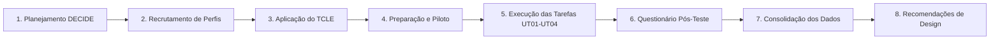

### Entrega 14 — Avaliação de usabilidade por observação de usuários

**Data:** 16/11/2026

**Status:** 🟩 concluída

**Responsabilidade:** Solução consolidada por equipe (2 participantes observados, sendo 1 por integrante).

#### Objetivo da atividade

Observar usuários representativos realizando tarefas reais ou realisticamente simuladas no protótipo BMML para identificar problemas de eficácia, eficiência, compreensão e satisfação que não puderam ser inferidos apenas por inspeção. A avaliação investiga estritamente a **qualidade da interação e da interface**, sem julgar o mérito técnico ou científico dos algoritmos e compiladores do TCC.

---

#### A. Fluxograma do processo — equipe

---

#### B. Procedimento de preparação e execução — equipe

##### Passo 1 — Objetivos e versão avaliada

* **Versão/Figma:** Protótipo de Telas BMML (Telas F01 a F07 catalogadas na Entrega 11).
* **Metas de usabilidade relacionadas:** Eficácia de leitura de dados de benchmark sem assistência (conclusão em < 60s), eficiência na filtragem paramétrica de séries (conclusão em < 90s) e transparência na identificação de hardware e comandos de reprodução (< 45s).

##### Passo 2 — Participantes

| ID | Perfil | Critérios que justificam participação (*Proxy*) | Integrante responsável |
| :---: | :--- | :--- | :--- |
| **U01** | Estudante de Ciência da Computação / Eng. (8º ciclo) | Conhecimento prévio em linguagens compiladas (C, Rust), complexidade de algoritmos e familiaridade com gráficos de dispersão. Atua como participante *proxy* representando a persona Rafael Mendes (Desenvolvedor). | João Pedro Bazoli Palma |
| **U02** | Estudante de Ciência da Computação / Eng. (8º ciclo) | Conhecimento prático de sistemas operacionais, ambiente Linux, uso de terminal e testes de software. Atua como participante *proxy* representando a persona Mariana Costa (Pesquisadora/Auditora). | Augusto Pereira Teixeira |

> **Nota metodológica (Participantes Proxy):** Devido à proximidade com a conclusão do curso e ao domínio consolidado dos conceitos da área (compilação, consumo de memória, CPU e análise experimental), os participantes possuem repertório técnico suficiente para simular com realismo as tarefas do sistema. Contudo, por serem participantes acadêmicos (*proxy*) e não profissionais sêniores atuando no mercado corporativo ou pós-graduação estrita, os resultados foram consolidados cientes dessa limitação amostral.

##### Passo 3 — Consentimento e privacidade

* **Termo de consentimento:** Termo formal aplicado e assinado antes da sessão ([consentimento.md](../instrumentos/consentimento.md)).
* **Gravação:** Não houve gravação de áudio ou vídeo da imagem dos participantes. O registro foi feito exclusivamente por anotações em tempo real do observador em planilha estruturada.
* **Anonimização:** Participantes identificados estritamente pelos códigos anônimos U01 e U02.
* **Armazenamento:** Planilhas e formulários brutos arquivados digitalmente no repositório restrito da equipe, com descarte previsto ao final do semestre letivo.

##### Passo 4 — Teste piloto

* **Data:** 16/11/2026.
* **O que foi validado:** Clareza do roteiro de tarefas neutras, calibração do cronômetro, tempo médio de realização e fluidez de navegação entre as telas do protótipo.
* **Mudanças após piloto:** Ajustou-se a formulação da tarefa UT02 para deixar explícito o objetivo de comparar apenas duas séries (ocultando as demais), evitando dúvidas sobre quais linguagens deveriam permanecer no gráfico.

##### Passo 5 — Tarefas

| ID | Cenário / Instrução apresentada | Critério de sucesso | Métricas | Ligação com modelo |
| :---: | :--- | :--- | :--- | :---: |
| **UT01** | *"Acesse o benchmark 'MergeSort' e descubra qual linguagem teve o menor tempo médio de execução."* | Identificar a linguagem mais rápida lendo o menor valor na tabela ordenada. | Sucesso, tempo (s), erros, ajudas, satisfação (1-5). | F01 → F02 (M01 / O01) |
| **UT02** | *"No gráfico do MergeSort, deixe visíveis apenas as linguagens C e Rust e ative a escala logarítmica no eixo Y."* | Desmarcar as demais séries na tabela de seleção e ativar o switch `Log Y`. | Sucesso, tempo (s), erros, ajudas, satisfação (1-5). | F02, F03 (M01 / O01) |
| **UT03** | *"Descubra qual é o modelo do processador (CPU) e o total de memória RAM da máquina em que os testes rodaram."* | Localizar e acionar o botão `About` no cabeçalho superior. | Sucesso, tempo (s), erros, ajudas, satisfação (1-5). | F06 (M02 / About) |
| **UT04** | *"Copie o comando de terminal necessário para reproduzir este ambiente de benchmark na sua máquina."* | Acessar a aba de código/reprodutibilidade e clicar no botão `Copy` da receita Guix. | Sucesso, tempo (s), erros, ajudas, satisfação (1-5). | F04, F07 (M02 / O02) |

##### Passo 6 — Protocolo do moderador

1. Receber o participante, agradecer a colaboração e enfatizar que **o protótipo está sendo avaliado, não a pessoa**.
2. Apresentar o termo de consentimento livre e esclarecido e obter o aceite formal.
3. Coletar breve perfil acadêmico (período e experiência prática com programação).
4. Ler as instruções de cada tarefa de forma neutra, sem indicar locais de clique ou nomes exatos de botões.
5. Observar atentamente a navegação sem ensinar caminhos, anotando hesitações, comentários e tempos.
6. Aplicar a técnica de pensar em voz alta (*think-aloud*), solicitando que o participante verbalize o que procura na tela.
7. Aplicar a pergunta de facilidade imediata (escala de 1 a 5) logo após a conclusão de cada tarefa.
8. Aplicar o questionário pós-teste rápido ao término da sessão.
9. Encerrar formalmente, esclarecer eventuais dúvidas sobre a pesquisa e reiterar o uso anônimo dos dados.

---

#### C. Resultados — por participante

##### U01 — Estudante de Ciência da Computação (8º ciclo) (Moderador: João Pedro)

| Tarefa | Grau de sucesso | Erros | Tipos de erro / Dificuldade | Ajudas | Tempo | Satisfação | Evidência / Observação |
| :---: | :---: | :---: | :--- | :---: | :---: | :---: | :--- |
| **UT01** | Total | 0 | Nenhuma dificuldade. | 0 | 00:28 | 5 | Clicou diretamente no card do MergeSort e leu o topo da tabela. *"A tabela já dá a média mastigada."* |
| **UT02** | Total | 1 | Clicou repetidas vezes para desmarcar linguagens uma a uma. | 0 | 00:44 | 4 | Achou o switch `Log Y` de primeira, mas reclamou do esforço manual de cliques. *"Podia ter um desmarcar tudo."* |
| **UT03** | Total | 0 | Nenhuma dificuldade. | 0 | 00:22 | 5 | Visualizou o botão `About` no cabeçalho e leu as especificações imediatamente. |
| **UT04** | Total | 0 | Breve hesitação (5s) procurando a aba de código. | 0 | 00:39 | 5 | Localizou o bloco do Guix e clicou no botão `Copy`. *"Gostei do botão de copiar direto pro terminal."* |

* **Link da gravação:** Não aplicável (sessão registrada exclusivamente em planilha de notas).
* **Resposta pós-teste:** *"A ferramenta é visualmente muito limpa e rápida. O modo escuro ajuda muito na leitura dos gráficos. A única melhoria que senti falta foi poder desmarcar todas as séries de uma só vez na tabela."*

---

##### U02 — Estudante de Ciência da Computação (8º ciclo) (Moderador: Augusto)

| Tarefa | Grau de sucesso | Erros | Tipos de erro / Dificuldade | Ajudas | Tempo | Satisfação | Evidência / Observação |
| :---: | :---: | :---: | :--- | :---: | :---: | :---: | :--- |
| **UT01** | Total | 0 | Nenhuma dificuldade. | 0 | 00:31 | 5 | Entrou no benchmark e confirmou o menor tempo numérico direto na tabela. |
| **UT02** | Total | 0 | Desmarcou pacientemente todas as séries indesejadas. | 0 | 00:48 | 4 | Localizou e ativou o toggle `Log Y`. Percebeu a redistribuição dos pontos no gráfico. |
| **UT03** | Total | 0 | Tentou fechar o modal clicando na área escura de fundo. | 0 | 00:26 | 4 | Identificou CPU e RAM rapidamente, mas tentou fechar clicando fora antes de buscar o 'X'. *"Achei que fechava no fundo."* |
| **UT04** | Total | 0 | Nenhuma dificuldade. | 0 | 00:33 | 5 | Acessou a aba de código, localizou o comando Guix e copiou com feedback visual imediato. |

* **Link da gravação:** Não aplicável (sessão registrada exclusivamente em planilha de notas).
* **Resposta pós-teste:** *"Achei excelente a transparência do ambiente com o comando do Guix e as especificações de hardware. Facilita muito a conferência dos testes. Como detalhe, o modal About deveria fechar clicando fora ou no Esc."*

---

#### D. Consolidação por tarefa

| Tarefa | Taxa de sucesso | Tempo típico | Erros recorrentes | Satisfação | Meta atendida? | Problemas prioritários |
| :---: | :---: | :---: | :--- | :---: | :---: | :--- |
| **UT01** | 100% (2/2) | 29,5s | Nenhum erro detectado. | 5.0 / 5 | **Sim** (Meta < 60s) | Nenhum. Tabela ordenada e legível atende plenamente ao objetivo. |
| **UT02** | 100% (2/2) | 46,0s | Excesso de cliques manuais em caixas de seleção. | 4.0 / 5 | **Sim** (Meta < 90s) | Inexistência de atalhos rápidos "Select All / Deselect All". |
| **UT03** | 100% (2/2) | 24,0s | Tentativa intuitiva de fechar modal clicando no backdrop. | 4.5 / 5 | **Sim** (Meta < 45s) | Modal About responde apenas ao botão físico de fechar ('X'). |
| **UT04** | 100% (2/2) | 36,0s | Pequena hesitação inicial na identificação da aba de código. | 5.0 / 5 | **Sim** (Meta < 60s) | Reforçar destaque visual da navegação por abas. |

---

#### E. Achados e recomendações

| ID | Achado | Evidência (quant. + qual.) | Impacto | Recomendação | Artefatos a revisar |
| :-: | :--- | :--- | :--- | :--- | :--- |
| **AU01** | Sobrecarga de cliques manuais para isolar séries específicas no gráfico. | 2 de 2 participantes comentaram sobre a ausência de atalho de seleção; tempo médio de UT02 foi o mais elevado (46s). | Médio (agilidade de uso / H7). | Incluir botões "Select All" e "Deselect All" logo acima da tabela de médias. | Protótipo / Tabela F03. |
| **AU02** | Expectativa de fechamento de janela modal clicando na área externa (*backdrop*). | Participante U02 tentou fechar o modal About clicando no fundo escuro antes de procurar o botão 'X'. | Baixo (cosmético / H3). | Permitir fechar o modal clicando na área escura externa ou pressionando a tecla `Esc`. | Protótipo / Modal F06. |
| **AU03** | Ampla aprovação da cópia assistida de scripts e visibilidade de dados de calibração. | 100% de sucesso e satisfação nota 5 em UT04; elogios explícitos de ambos os usuários. | Positivo (reforço de valor semiótico). | Preservar os botões interativos `Copy` e o link ubíquo `About` no cabeçalho permanente. | Manter especificação atual. |

---

#### F. Comparação com a avaliação heurística

| Problema | Detectado na heurística? | Detectado por usuários? | O que aprendemos |
| :--- | :---: | :---: | :--- |
| Inexistência de atalho para selecionar/desmarcar todas as séries (H7) | **Sim** (V02 / HC02) | **Sim** (AU01) | A heurística antecipou com precisão o incômodo operacional que os usuários sentiram ao ter que desmarcar caixas uma a uma. |
| Modal About só fecha através do botão 'X' (H3) | **Sim** (V03 / HC03) | **Sim** (AU02) | A violação de convenções comuns de navegação web causa hesitação perceptível, mesmo em ações secundárias. |
| Risco de gráfico vazio ao desmarcar todas as séries (H5) | **Sim** (V01 / HC01) | **Não** | O cenário de teste guiado solicitava a manutenção de duas séries marcadas; o risco de erro crítico permanece latente e deve ser prevenido. |

---

#### G. Conclusão

1. **Metas de usabilidade atingidas:** Todas as metas foram alcançadas com 100% de eficácia (sucesso total em todas as tarefas sem nenhuma intervenção do moderador). Os tempos de execução ficaram amplamente abaixo dos limites estipulados (média global de 33,8 segundos).
2. **Problemas recorrentes:** O único atrito sistemático observado esteve concentrado na tarefa UT02 (esforço repetitivo de cliques para desmarcar múltiplas séries na tabela), confirmando a previsão da avaliação heurística.
3. **Surpresas da equipe:** A naturalidade com que ambos os participantes encontraram as especificações técnicas da máquina de testes no cabeçalho superior (média de 24 segundos na tarefa UT03), demonstrando que o signo `About` foi bem compreendido.
4. **Mudanças prioritárias:** Inclusão dos atalhos "Select All / Deselect All" na tabela de séries e suporte ao fechamento do modal About via clique externo e tecla `Esc`.
5. **Limitações do teste:** Os participantes avaliados são estudantes do 8º ciclo atuando como participantes *proxy*. Embora possuam a bagagem teórica e prática necessária para operar a ferramenta e compreender os termos técnicos de compiladores e sistemas, a amostra é acadêmica e seus resultados representam uma aproximação das personas finais de mercado e pesquisa científica estrita.

---

#### Checklist

* [x] Número de participantes finais atende ao enunciado (2 participantes para 2 integrantes).
* [x] Participantes são representativos do público e não são membros da equipe.
* [x] Se foram usados participantes proxy, a justificativa e a limitação estão explícitas.
* [x] O teste avalia a interação; não confunde usabilidade do protótipo com desempenho técnico do TCC.
* [x] Tarefas administrativas/analíticas usadas no teste são rastreáveis a objetivos e cenários.
* [x] Há consentimento e anonimização.
* [x] Foi realizado teste piloto.
* [x] Tarefas têm critérios de sucesso definidos antes do teste.
* [x] Moderadores não ensinaram o caminho durante a tarefa.
* [x] Resultados estão separados por usuário e por tarefa.
* [x] Foram registrados sucesso, erros, ajudas, tempo e satisfação quando aplicáveis.
* [x] Conclusão combina evidência quantitativa e qualitativa.
* [x] Achados geram recomendações e atualização da rastreabilidade.
